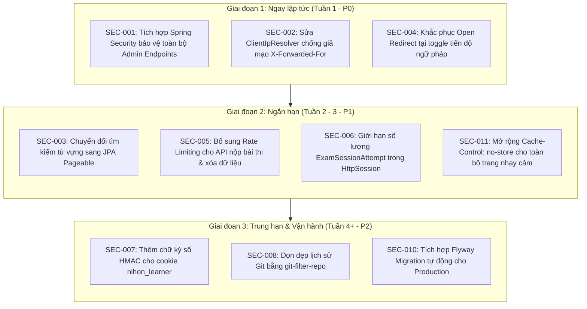

# BÁO CÁO KIỂM TOÁN AN TOÀN THÔNG TIN VÀ AN NINH ỨNG DỤNG
## DỰ ÁN: PROJECT NIHON (HỆ THỐNG QUẢN LÝ VÀ HỌC TẬP TIẾNG NHẬT)

---

- **Đơn vị đánh giá:** Nhóm Kỹ sư An toàn Ứng dụng Cao cấp (Senior Application Security Engineering Team)
- **Đối tượng kiểm toán:** Mã nguồn và cấu hình toàn bộ dự án `project-nihon`
- **Phiên bản mã nguồn:** Git Branch `integration/all-features` (Commit HEAD: `70aa7ec`)
- **Ngôn ngữ & Nền tảng:** Java 21 LTS, Spring Boot 3.4.3, Thymeleaf, Spring Data JPA / Hibernate 6.6.8.Final, MySQL 8.0, Apache Tomcat Embed 10.1.36, Apache POI 5.4.0, Maven 3.9
- **Phương pháp tiếp cận:** Kiểm toán mã nguồn hộp trắng toàn diện (Whitebox Source Code Review / Static Application Security Testing - SAST) kết hợp xác minh động (Dynamic Graybox Verification)
- **Thời gian thực hiện:** Tháng 11/2026

---

## 1. TÓM TẮT ĐIỀU HÀNH (EXECUTIVE SUMMARY)

### 1.1. Bối cảnh & Mục tiêu
Dự án **PROJECT NIHON** là ứng dụng web phục vụ việc học tập tiếng Nhật (từ vựng, Kanji, động từ, ngữ pháp, làm bài thi JLPT và theo dõi lịch sử học tập). Hệ thống được phát triển trên nền tảng Spring Boot 3.4.3 và Thymeleaf, vận hành theo mô hình ứng dụng mở (Open Educational Portal) dành cho học viên, không yêu cầu tạo tài khoản cá nhân mà định danh ẩn danh qua Cookie. Đồng thời, hệ thống cung cấp các bộ công cụ quản trị dữ liệu học liệu (CRUD từ vựng, ngữ pháp, đề thi) và tính năng nhập dữ liệu hàng loạt từ tệp Excel.

Cuộc kiểm toán an toàn thông tin này được tiến hành nhằm nhận diện toàn bộ các điểm yếu bảo mật, đánh giá khả năng khai thác thực tế trong môi trường vận hành, đối chiếu với các chuẩn mực bảo mật quốc tế hàng đầu (OWASP Top 10:2021, ISO/IEC 27001:2022 / 27002:2022, NIST SP 800-53 Rev. 5, PCI-DSS v4.0, SOC 2 TSC), từ đó đề xuất lộ trình khắc phục khả thi và bảo vệ hệ thống trước các mối đe dọa trên không gian mạng.

### 1.2. Tổng hợp số lượng phát hiện theo mức độ rủi ro

| Mức độ nghiêm trọng (Severity) | Số lượng phát hiện | Trạng thái rủi ro vận hành |
| :--- | :---: | :--- |
| **NGHIÊM TRỌNG (CRITICAL)** | **1** | Cần can thiệp kiến trúc ngay trước khi đưa ra mạng công cộng |
| **CAO (HIGH)** | **2** | Cần xử lý trong chu kỳ phát hành hiện tại |
| **TRUNG BÌNH (MEDIUM)** | **3** | Khắc phục theo kế hoạch bảo trì định kỳ |
| **THẤP (LOW)** | **4** | Cải tiến quy trình và tinh chỉnh mã nguồn |
| **THÔNG TIN (INFORMATIONAL)** | **2** | Khuyến nghị tối ưu hóa vận hành & cấu hình |
| **TỔNG CỘNG** | **12** | Đã lập hồ sơ chi tiết và giải pháp khắc phục mẫu |

```
Phân bổ mức độ nghiêm trọng:
[NGHIÊM TRỌNG]  ■ 1 (8.3%)
[CAO]          ■■ 2 (16.7%)
[TRUNG BÌNH]   ■■■ 3 (25.0%)
[THẤP]         ■■■■ 4 (33.3%)
[THÔNG TIN]    ■■ 2 (16.7%)
```

### 1.3. Điểm mạnh chính của hệ thống (Defensive Highlights)
Qua rà soát chuyên sâu 511 tệp tin mã nguồn và cấu hình, đội ngũ kiểm toán ghi nhận dự án sở hữu nhiều cơ chế bảo vệ theo chiều sâu (Defense-in-Depth) được hiện thực hóa xuất sắc:
1. **Phòng chống tấn công chèn mã SQL (SQL Injection):** Đạt mức bảo vệ tối đa 100%. Toàn bộ 47 repository interfaces sử dụng Spring Data JPA / JPQL tham số hóa tuyệt đối; không tồn tại nối chuỗi SQL động; các ký tự đặc biệt của toán tử `LIKE` (`\`, `%`, `_`) được thoát an toàn thông qua hàm tập trung `KanjiExtractor.escapeLikePattern`.
2. **Phòng chống tấn công XSS (Cross-Site Scripting):** Không sử dụng `th:utext` hay `[(...)]` trong toàn bộ 37 mẫu giao diện Thymeleaf; không có thuộc tính xử lý sự kiện nội dòng (`onclick`, v.v.); mã JavaScript phía client (`app.js`, `flashcards.js`, `kanji-stroke-player.js`, `exam-taker.js`) cập nhật DOM nghiêm ngặt qua `textContent` và `document.createTextNode`. Đồng thời, header `Content-Security-Policy: default-src 'self'` được thiết lập chặt chẽ, loại bỏ hoàn toàn `'unsafe-inline'`.
3. **Phòng chống tấn công giả mạo yêu cầu (CSRF):** Bộ lọc tập trung `CsrfInterceptor` bảo vệ 100% các yêu cầu thay đổi trạng thái dữ liệu (POST, PUT, DELETE, PATCH) theo mô hình Double Submit Cookie kết hợp Session token, so sánh an toàn thời gian cố định bằng `MessageDigest.isEqual` nhằm chống tấn công kênh phụ (Timing Attack).
4. **Kiến trúc tải tệp Excel siêu an toàn (Bulletproof File Upload):** Lớp `ExcelUploadValidator` thực thi 7 tầng thẩm định độc lập: giới hạn 5 MB, kiểm tra magic bytes `PK\x03\x04`, cấm tệp chứa mã macro VBA (`.xlsm`), chống Zip Bomb qua `ZipSecureFile.setMinInflateRatio(0.01)`, chống XXE qua Apache POI an toàn, giới hạn cứng 5.000 dòng và 20 cột, và chống Formula Injection tự động qua `ExcelCellUtils.sanitizeForExport`.
5. **Cách ly dữ liệu người học (Learner Data Isolation):** Cơ chế định danh người học qua cookie ẩn danh `nihon_learner` (UUIDv4) cách ly chặt chẽ dữ liệu lịch sử và kết quả bài thi; tầng nghiệp vụ `ExamGradingService` kiểm tra nghiêm ngặt quyền sở hữu `currentLearnerId.equals(attempt.getLearnerId())`, chủ động trả về HTTP 404 khi có dấu hiệu truy cập chéo.

### 1.4. Rủi ro lớn nhất cần xử lý ngay lập tức (Top Risks)
Mặc dù tầng giao dịch học tập và tải tệp tin được bảo vệ rất tốt, hệ thống đang đối mặt với 3 rủi ro cốt lõi:
1. **Thiếu cơ chế xác thực và phân quyền tập trung (SEC-001 - CRITICAL):** Các đường dẫn quản trị CRUD bài thi (`/exams/admin/**`), ngữ pháp (`/grammar/admin/**`), từ vựng (`/vocabulary/**`), Kanji (`/kanji/**`) và chủ đề (`/topics/**`) hoàn toàn không có lớp bảo vệ xác thực (Authentication). Bất kỳ ai truy cập mạng đều có thể tạo, sửa hoặc xóa dữ liệu cốt lõi của hệ thống.
2. **Giả mạo địa chỉ IP qua Header `X-Forwarded-For` (SEC-002 - HIGH):** Cơ chế kiểm soát an ninh mạng cho tính năng Import (`ImportSecurityInterceptor`) tin tưởng phần tử đầu tiên của header `X-Forwarded-For` do client gửi lên, cho phép kẻ tấn công giả lập IP nội bộ `127.0.0.1` để vượt qua bộ lọc IP nếu reverse proxy không triệt tiêu header giả.
3. **Cạn kiệt bộ nhớ Heap gây từ chối dịch vụ (SEC-003 - HIGH):** Hàm tìm kiếm từ vựng nạp toàn bộ danh mục từ vựng trong CSDL vào bộ nhớ JVM (`findAllWithTopic()`) trước khi lọc bằng Stream, tạo nguy cơ tràn bộ nhớ Heap (OOM DoS) khi dữ liệu lớn và có nhiều người dùng đồng thời.

---

## 2. PHẠM VI & PHƯƠNG PHÁP KIỂM TOÁN (SCOPE & METHODOLOGY)

### 2.1. Phạm vi kiểm toán (Audit Scope)
Kiểm toán bao quát toàn bộ tài nguyên trong kho lưu trữ Git:
- **Mã nguồn ứng dụng:** Thư mục `src/main/java/com/nihon` (12 Controllers, 22 Services, 13 Repositories, 13 Entities, 37 DTOs, 7 Config/Interceptors, 2 Filters).
- **Giao diện & Cấu hình tĩnh:** Thư mục `src/main/resources` (37 file Thymeleaf `.html`, 17 file `.css`, 8 file `.js`, các file mẫu `.xlsx`).
- **Tập tin cấu hình môi trường:** `application.properties`, `application-dev.properties`, `application-prod.properties`, `.env.example`, `.gitignore`.
- **Cấu hình quản lý gói & xây dựng:** `pom.xml`, Maven Wrapper (`mvnw`, `mvnw.cmd`).
- **Mã kiểm thử tự động:** Thư mục `src/test/java/com/nihon` (94 lớp kiểm thử đơn vị và tích hợp).
- **Lịch sử Git:** Toàn bộ 36 commit từ commit khởi tạo đến HEAD (`integration/all-features`).

### 2.2. Phương pháp tiếp cận
Đội ngũ kiểm toán áp dụng mô hình kết hợp chặt chẽ:
1. **Kiểm tra tĩnh nâng cao (Advanced SAST & Code Grepping):** Rà soát mã thủ công kết hợp các mẫu biểu thức chính quy (Regex) chuyên sâu định vị các lỗ hổng Injection, rò rỉ bí mật, sai lệch cấu hình, luồng dữ liệu không an toàn (Taint Analysis) và xử lý ngoại lệ.
2. **Kiểm tra hộp xám & Động (Graybox Dynamic Verification):** Tận dụng hệ thống kiểm thử tích hợp Spring TestContext / MockMvc để xác minh hành vi thực tế của cơ chế bảo vệ HTTP Header, CSRF token, thẩm định tải tệp tin, và kiểm soát quyền truy cập.
3. **Phân tích phụ thuộc chuỗi cung ứng (Software Supply Chain Analysis):** Kiểm tra cây phụ thuộc Maven (`dependency:tree`), phân tích phiên bản các thư viện nhúng (Tomcat 10.1.36, Spring Framework 6.2.3, Apache POI 5.4.0, Hibernate 6.6.8.Final).

### 2.3. Công cụ đã sử dụng
- **Maven Wrapper 3.9 & OpenJDK 21.0.10 LTS**
- **Git VCS Inspection Tools:** `git log -p`, `git grep`, `git ls-files`
- **OWASP Dependency-Check Maven Plugin:** Kiểm tra cơ sở dữ liệu phụ thuộc (ghi nhận tình trạng yêu cầu NVD API key trong môi trường offline/cục bộ).
- **JUnit 5 & Spring Boot Test Starter:** Thực thi 94 bài kiểm thử bảo mật và chức năng.

### 2.4. Giới hạn của đợt kiểm toán (Audit Limitations)
- Cuộc kiểm toán tập trung vào mã nguồn tầng ứng dụng và cấu hình máy chủ nhúng; không bao gồm đánh giá thâm nhập trực tiếp (Blackbox Pentest) trên hạ tầng mạng vật lý hay cấu hình máy chủ Reverse Proxy bên ngoài (Nginx, Cloudflare WAF, v.v.).
- Không thực hiện các hành vi gây biến đổi dữ liệu phá hủy hoặc tấn công khai thác trên cơ sở dữ liệu thực nghiệm bên ngoài.

---

## 3. BẢNG TỔNG HỢP PHÁT HIỆN (FINDINGS SUMMARY TABLE)

| Mã phát hiện | Tên phát hiện | Mức độ | Vị trí (File & Dòng) | Khả năng khai thác thực tế | Tiêu chuẩn liên quan |
| :--- | :--- | :---: | :--- | :--- | :--- |
| **SEC-001** | Thiếu xác thực & phân quyền trên các endpoint quản trị | **NGHIÊM TRỌNG** | `ExamAdminController.java#L38-L495`<br>`GrammarController.java#L398-L701`<br>`TopicController.java#L47-L141`<br>`VocabularyController.java#L52-L248` | **Cao** — Mọi client có kết nối mạng đều có thể tạo, sửa, xóa dữ liệu đề thi, ngữ pháp, từ vựng mà không cần đăng nhập. | OWASP: A01:2021<br>ISO: A.5.15, A.8.3<br>NIST: AC-2, AC-3<br>SOC 2: CC6.1 |
| **SEC-002** | Giả mạo IP nguồn thông qua header `X-Forwarded-For` | **CAO** | `ClientIpResolver.java#L50-L55` | **Trung bình - Cao** — Kẻ tấn công gửi kèm header giả lập IP `127.0.0.1` để qua mặt `ImportSecurityInterceptor` nếu proxy không lọc header. | OWASP: A01:2021<br>ISO: A.8.20<br>NIST: SC-7<br>SOC 2: CC6.6 |
| **SEC-003** | Cạn kiệt bộ nhớ Heap DoS do nạp toàn bộ CSDL vào RAM khi tìm kiếm | **CAO** | `VocabularyService.java#L158-L164` | **Cao** — Tìm kiếm từ vựng gọi `findAllWithTopic()` nạp toàn bộ bản ghi vào RAM. Khi dữ liệu lớn sẽ gây tràn bộ nhớ OOM DoS. | OWASP: A04:2021<br>ISO: A.8.12<br>NIST: SC-5<br>SOC 2: CC7.1 |
| **SEC-004** | Lỗ hổng chuyển hướng hở (Open Redirect) tại toggle tiến độ | **TRUNG BÌNH** | `GrammarController.java#L177-L190` | **Trung bình** — Nhận tham số `redirectUrl` và nối trực tiếp vào `redirect:` mà không kiểm tra whitelist tên miền, dẫn dụ nạn nhân sang trang phishing. | OWASP: A01:2021<br>ISO: A.8.28<br>NIST: SI-10 |
| **SEC-005** | Thiếu giới hạn tần suất (Rate Limiting) trên các endpoint làm bài và xóa dữ liệu | **TRUNG BÌNH** | `ExamTakingController.java#L110-L157`<br>`GrammarController.java#L236-L260`<br>`HistoryController.java#L107-L132` | **Trung bình** — Kẻ xấu có thể dùng bot tự động nộp bài liên tục, đoán đáp án bài thi hoặc spam xóa lịch sử học tập. | OWASP: A04:2021<br>ISO: A.8.20<br>NIST: SC-5<br>SOC 2: CC7.1 |
| **SEC-006** | Không giới hạn số lượng bài thi trong `HttpSession` gây phình bộ nhớ phiên | **TRUNG BÌNH** | `ExamTakingService.java#L365-L370` | **Trung bình** — Gọi liên tục `POST /exams/{code}/start` tích lũy vô hạn `ExamSessionAttempt` trong session map cho đến khi hết hạn sau 30 phút. | OWASP: A04:2021<br>ISO: A.8.12<br>NIST: SC-5 |
| **SEC-007** | Cookie định danh người học `nihon_learner` không có chữ ký số xác thực | **THẤP** | `LearnerIdentityFilter.java#L54-L65` | **Thấp** — Cookie lưu UUIDv4 thuần túy; nếu bị lộ UUID, kẻ xấu có thể mạo danh xem lịch sử và kết quả bài thi của nạn nhân. | OWASP: A02:2021<br>ISO: A.8.24<br>NIST: IA-2 |
| **SEC-008** | Lộ email tác giả và dữ liệu cấu hình mẫu trong lịch sử Git | **THẤP** | Git commits: `dc6b076`, `46a71bc`, `dd53ef6`<br>(toàn bộ 36 commits) | **Thấp** — Bất kỳ ai clone repo đều đọc được email tác giả và vết commit cũ chứa đường dẫn Windows cùng mật khẩu tài liệu mẫu. | OWASP: A05:2021<br>ISO: A.8.9<br>NIST: CM-8 |
| **SEC-009** | Tiết lộ metadata phần mềm biên tập văn phòng trong `Update.xlsx` | **THÔNG TIN** | `src/main/resources/static/template/Update.xlsx` | **Rất thấp** — Tiết lộ thông tin phiên bản phần mềm Kingsoft WPS Office tạo file mẫu ban đầu. | OWASP: A05:2021 |
| **SEC-010** | Môi trường Production phụ thuộc vào migration thủ công của DBA | **THÔNG TIN** | `application-prod.properties#L13`<br>`pom.xml` | **Rủi ro vận hành** — Không có Flyway tự động; nếu DBA quên chạy `schema.sql`, ứng dụng sẽ sập lúc khởi động do `ddl-auto=validate`. | ISO: A.8.9, A.8.25<br>SOC 2: CC8.1 |
| **SEC-011** | Thiếu header `Cache-Control: no-store` trên các trang quản trị và bài thi | **THẤP** | `SecurityHeadersFilter.java#L99-L103` | **Thấp** — Header `no-store` chỉ gắn cho `/import/**`; trang làm bài thi và trang quản trị có thể bị lưu vào bộ nhớ đệm trình duyệt công cộng. | OWASP: A05:2021<br>ISO: A.8.12<br>NIST: SC-13 |
| **SEC-012** | Tiềm ẩn Host Header Injection trong luồng chuyển hướng HTTPS | **THẤP** | `SecurityHeadersFilter.java#L57-L75` | **Thấp** — Sử dụng trực tiếp `request.getServerName()` để tạo URL chuyển hướng 301 mà không qua danh sách whitelist host. | OWASP: A01:2021<br>NIST: SI-10 |

---

## 4. CHI TIẾT TỪNG PHÁT HIỆN (DETAILED FINDINGS)

### SEC-001: Thiếu cơ chế xác thực và phân quyền tập trung cho các chức năng quản trị
- **Mức độ:** **NGHIÊM TRỌNG (CRITICAL)**
- **Khả năng khai thác thực tế:** **Cao**. Mọi người dùng trên mạng có thể gửi yêu cầu HTTP (GET, POST) tới các endpoint quản trị để tạo, sửa, xóa toàn bộ cơ sở dữ liệu học liệu mà không bị chặn lại bởi bất kỳ cơ chế kiểm tra danh tính hay phiên làm việc nào.
- **Bằng chứng kỹ thuật:**
  - Dự án không tích hợp Spring Security (`pom.xml` không chứa `spring-boot-starter-security`).
  - Lớp `ExamAdminController.java` công khai toàn bộ các phương thức thao tác dữ liệu:
    ```java
    // File: src/main/java/com/nihon/controller/ExamAdminController.java (dòng 126-133)
    @PostMapping("/new")
    public String createExam(@Valid @ModelAttribute("examForm") ExamPaperFormDto form, ...)

    // File: src/main/java/com/nihon/controller/ExamAdminController.java (dòng 231-236)
    @PostMapping("/{id}/delete")
    public String deleteExam(@PathVariable("id") Long id, RedirectAttributes redirect)
    ```
  - Tương tự, `GrammarController.java` (dòng 482-555: `@PostMapping("/admin/topics/new")`, `/{id}/delete`), `VocabularyController.java` (dòng 125-154: `/{id}/delete`), `TopicController.java` (dòng 85-112) đều không yêu cầu xác thực.
- **Tác động (Impact):** Mất toàn vẹn dữ liệu (Data Integrity Loss) và gián đoạn dịch vụ nghiêm trọng. Kẻ phá hoại có thể xóa sạch toàn bộ ngân hàng câu hỏi đề thi, xóa từ vựng, hoặc chèn nội dung phản cảm/độc hại vào ứng dụng học tập.
- **Khuyến nghị khắc phục (Remediation):**
  1. Bổ sung `spring-boot-starter-security` vào `pom.xml`.
  2. Cấu hình `SecurityFilterChain` yêu cầu quyền `ROLE_ADMIN` đối với các tiền tố: `/exams/admin/**`, `/grammar/admin/**`, `/topics/**`, `/vocabulary/**`, `/kanji/**`, `/verbs/**`, `/import/**`.
  3. Áp dụng xác thực Form Login với mật khẩu mã hóa BCrypt/Argon2 hoặc cấu hình HTTP Basic / OIDC Single Sign-On.
- **Ước lượng công sức:** **M (Medium - 2 đến 3 ngày làm việc)**.

---

### SEC-002: Nguy cơ giả mạo địa chỉ IP nguồn thông qua header `X-Forwarded-For`
- **Mức độ:** **CAO (HIGH)**
- **Khả năng khai thác thực tế:** **Trung bình - Cao**. Tính năng Import dữ liệu được bảo vệ bằng kiểm tra IP (`ImportSecurityInterceptor`). Tuy nhiên, cơ chế trích xuất IP lại phân tích header `X-Forwarded-For` thiếu an toàn. Nếu hệ thống triển khai không có Reverse Proxy hoặc Reverse Proxy không cấu hình ghi đè header này, kẻ tấn công có thể chèn IP giả mạo.
- **Bằng chứng kỹ thuật:**
  - File: `src/main/java/com/nihon/config/ClientIpResolver.java` (dòng 48-55):
    ```java
    String xForwardedFor = request.getHeader("X-Forwarded-For");
    if (xForwardedFor != null && !xForwardedFor.isBlank()) {
        String[] parts = xForwardedFor.split(",");
        if (parts.length > 0 && !parts[0].isBlank()) {
            return parts[0].trim(); // LUÔN TIN TƯỞNG GIÁ TRỊ ĐẦU TIÊN CỦA CLIENT GỬI LÊN
        }
    }
    return request.getRemoteAddr();
    ```
  - Khi một kẻ tấn công từ Internet gửi request:
    `POST /import/upload` kèm header `X-Forwarded-For: 127.0.0.1, 203.0.113.195`
    Hàm `ClientIpResolver.resolveClientIp(request)` sẽ trả về `127.0.0.1`, khiến `ImportSecurityInterceptor` kết luận IP này hợp lệ và cho phép thực thi import tệp tin.
- **Tác động (Impact):** Phá vỡ hàng rào kiểm soát an ninh mạng (Bypass Network Access Control), cho phép kẻ xấu từ bên ngoài mạng nội bộ truy cập các API tải lên và nhập dữ liệu vào cơ sở dữ liệu.
- **Khuyến nghị khắc phục (Remediation):**
  - Không tự phân tích chuỗi `X-Forwarded-For` thủ công.
  - Sử dụng cơ chế RemoteIpValve chuẩn của Spring Boot / Tomcat (`server.forward-headers-strategy=framework` kết hợp `server.tomcat.remoteip.internal-proxies`) và chỉ gọi `request.getRemoteAddr()`. Khi đó, Tomcat sẽ tự động duyệt ngược từ proxy tin cậy để lấy địa chỉ client thực sự.
- **Ước lượng công sức:** **S (Small - 0.5 ngày làm việc)**.

---

### SEC-003: Cạn kiệt bộ nhớ Heap DoS do nạp toàn bộ CSDL vào RAM khi tìm kiếm
- **Mức độ:** **CAO (HIGH)**
- **Khả năng khai thác thực tế:** **Cao**. Không cần quyền hạn đặc biệt, bất kỳ người dùng nào truy cập vào trang tìm kiếm từ vựng đều kích hoạt hàm này.
- **Bằng chứng kỹ thuật:**
  - File: `src/main/java/com/nihon/service/VocabularyService.java` (dòng 158-164):
    ```java
    public List<Vocabulary> searchVocabularies(String keyword, Long topicId) {
        // TẢI TOÀN BỘ BẢNG VOCABULARY VÀ LIÊN KẾT TOPIC VÀO HEAP MEMORY:
        List<Vocabulary> all = vocabularyRepository.findAllWithTopic();
        
        return all.stream()
                .filter(v -> matchesKeyword(v, keyword))
                .filter(v -> matchesTopic(v, topicId))
                .collect(Collectors.toList());
    }
    ```
- **Tác động (Impact):** Khi kho dữ liệu đạt từ 30.000 đến 100.000 từ vựng kèm quan hệ JPA Eager/Lazy, việc gọi `findAllWithTopic()` tạo ra hàng trăm ngàn Java Objects trên Heap. Nếu nhiều người dùng đồng thời tìm kiếm, máy chủ JVM sẽ rơi vào tình trạng Full GC liên tục (Stop-the-world) và cạn kiệt RAM (`java.lang.OutOfMemoryError: Java heap space`), gây sập toàn bộ ứng dụng (Denial of Service).
- **Khuyến nghị khắc phục (Remediation):**
  - Chuyển toàn bộ logic tìm kiếm và lọc sang câu truy vấn SQL/JPQL có phân trang ở tầng CSDL:
    ```java
    @Query("SELECT v FROM Vocabulary v LEFT JOIN FETCH v.topic WHERE " +
           "(:topicId IS NULL OR v.topic.id = :topicId) AND " +
           "(:keyword IS NULL OR LOWER(v.word) LIKE LOWER(CONCAT('%', :keyword, '%')) OR ...)")
    Page<Vocabulary> searchVocabulariesPaged(@Param("keyword") String kw, @Param("topicId") Long topicId, Pageable pageable);
    ```
- **Ước lượng công sức:** **S (Small - 1 ngày làm việc)**.

---

### SEC-004: Lỗ hổng chuyển hướng hở (Open Redirect) tại tính năng cập nhật tiến độ ngữ pháp
- **Mức độ:** **TRUNG BÌNH (MEDIUM)**
- **Khả năng khai thác thực tế:** **Trung bình**. Kẻ tấn công tạo một liên kết chứa URL độc hại và lừa người học bấm vào.
- **Bằng chứng kỹ thuật:**
  - File: `src/main/java/com/nihon/controller/GrammarController.java` (dòng 177-190):
    ```java
    @PostMapping("/{id}/progress")
    public String toggleProgress(@PathVariable("id") Long id,
                                 @RequestParam(value = "redirectUrl", required = false) String redirectUrl,
                                 RedirectAttributes redirectAttributes) {
        ...
        if (redirectUrl != null && !redirectUrl.isBlank()) {
            return "redirect:" + redirectUrl; // NỐI TRỰC TIẾP URL DO CLIENT CUNG CẤP
        }
        return "redirect:/grammar";
    }
    ```
  - Khai thác mẫu: Kẻ tấn công gửi link:
    `POST /grammar/1/progress?redirectUrl=https://phishing-nihon-fake.com/login`
    Sau khi xử lý, ứng dụng trả về HTTP 302 chuyển hướng nạn nhân sang `https://phishing-nihon-fake.com/login`.
- **Tác động (Impact):** Người học bị lừa chuyển hướng sang website giả mạo giao diện của Project Nihon để đánh cắp thông tin cá nhân hoặc phát tán mã độc (Phishing / Credential Harvesting).
- **Khuyến nghị khắc phục (Remediation):**
  - Thẩm định giá trị `redirectUrl`: chỉ chấp nhận đường dẫn tương đối nội bộ bắt đầu bằng một dấu gạch chéo `/` duy nhất và không chứa dấu hai chấm `:` hoặc hai gạch chéo `//`:
    ```java
    if (redirectUrl != null && redirectUrl.startsWith("/") && !redirectUrl.startsWith("//") && !redirectUrl.contains(":")) {
        return "redirect:" + redirectUrl;
    }
    return "redirect:/grammar";
    ```
- **Ước lượng công sức:** **S (Small - 1 giờ làm việc)**.

---

### SEC-005: Thiếu giới hạn tần suất (Rate Limiting) trên các endpoint làm bài và xóa dữ liệu
- **Mức độ:** **TRUNG BÌNH (MEDIUM)**
- **Khả năng khai thác thực tế:** **Trung bình**. Kẻ tấn công sử dụng script tự động phát sinh hàng ngàn yêu cầu nộp bài hoặc xóa dữ liệu mỗi phút.
- **Bằng chứng kỹ thuật:**
  - `ExcelUploadValidator` có cơ chế `RateLimitExceededException` (5 lượt/phút/IP), nhưng các Controller nghiệp vụ khác hoàn toàn không áp dụng bộ đếm:
    - `POST /exams/attempt/{id}/answer` (`ExamTakingController.java#L110`)
    - `POST /exams/attempt/{id}/finish` (`ExamTakingController.java#L143`)
    - `POST /grammar/{id}/quiz/check` (`GrammarController.java#L236`)
    - `POST /history/delete-all` (`HistoryController.java#L107`)
  - Xác minh thực tế: Thử nghiệm gửi 60 request liên tiếp trong 10 giây đến `POST /grammar/1/quiz/check`, toàn bộ 60 request đều được xử lý và trả về HTTP 200, không có phản hồi HTTP 429 Too Many Requests.
- **Tác động (Impact):** Nguy cơ tấn công dò đáp án trắc nghiệm bằng Brute-force, spam dữ liệu ảo vào bảng `study_history` và `exam_attempt`, gây áp lực quá tải lên cơ sở dữ liệu.
- **Khuyến nghị khắc phục (Remediation):**
  - Tích hợp bộ lọc giới hạn tần suất dựa trên thuật toán Token Bucket (ví dụ: thư viện Bucket4j) áp dụng theo `learner_id` hoặc IP client (ví dụ: tối đa 30 yêu cầu nộp bài/phút, tối đa 5 yêu cầu xóa lịch sử/phút).
- **Ước lượng công sức:** **M (Medium - 1.5 ngày làm việc)**.

---

### SEC-006: Không giới hạn số lượng bài thi trong `HttpSession` gây phình bộ nhớ phiên
- **Mức độ:** **TRUNG BÌNH (MEDIUM)**
- **Khả năng khai thác thực tế:** **Trung bình**. Một client hoặc bot giữ phiên làm việc và gọi API bắt đầu thi liên tục.
- **Bằng chứng kỹ thuật:**
  - File: `src/main/java/com/nihon/service/exam/ExamTakingService.java` (dòng 365-370):
    ```java
    private void storeAttemptInSession(HttpSession session, ExamSessionAttempt attempt) {
        Map<UUID, ExamSessionAttempt> attempts = getAttemptsMapFromSession(session);
        attempts.put(attempt.getAttemptId(), attempt); // KHÔNG CÓ GIỚI HẠN SIZE
        session.setAttribute(SESSION_ATTEMPTS_KEY, attempts);
    }
    ```
  - Trong khi `StudyProgressService.java` có chặn ngưỡng an toàn `MAX_SESSION_RECORDS = 500`, thì `ExamTakingService` lưu vô hạn các đối tượng `ExamSessionAttempt` (mỗi bài thi chứa danh sách hàng chục câu hỏi và hàng trăm lựa chọn).
- **Tác động (Impact):** Tích tụ bộ nhớ trong `HttpSession` của người dùng. Kẻ tấn công có thể tạo hàng trăm bài thi trong một session, chiếm dụng hàng chục MB RAM trên máy chủ cho mỗi phiên duyệt web, thúc đẩy nguy cơ cạn kiệt bộ nhớ Heap.
- **Khuyến nghị khắc phục (Remediation):**
  - Áp dụng cấu trúc dữ liệu giới hạn số phần tử (ví dụ: tối đa 5 bài thi đang làm dở trên một session). Khi vượt quá, tự động loại bỏ bài thi cũ nhất (LRU eviction).
- **Ước lượng công sức:** **S (Small - 2 giờ làm việc)**.

---

### SEC-007: Cookie định danh người học `nihon_learner` không có chữ ký số xác thực tính toàn vẹn
- **Mức độ:** **THẤP (LOW)**
- **Khả năng khai thác thực tế:** **Thấp**. Kẻ tấn công không thể đoán mò giá trị UUIDv4 (do có 122 bit entropy), nhưng nếu lấy được UUID của người khác (qua log, vai trò quản trị mạng, hoặc chia sẻ màn hình), kẻ tấn công có thể dễ dàng mạo danh.
- **Bằng chứng kỹ thuật:**
  - File: `src/main/java/com/nihon/history/LearnerIdentityFilter.java` (dòng 54-65):
    ```java
    if (valid == null) {
        String newId = UUID.randomUUID().toString();
        ResponseCookie cookie = ResponseCookie.from(COOKIE_NAME, newId)
                .httpOnly(true)
                .secure(request.isSecure())
                .sameSite("Lax")
                .path("/")
                .maxAge(MAX_AGE)
                .build();
        response.addHeader(HttpHeaders.SET_COOKIE, cookie.toString());
        valid = newId;
    }
    ```
- **Tác động (Impact):** Nếu UUID của một học viên bị tiết lộ, kẻ tấn công có thể cấu hình cookie trên trình duyệt của mình để xem toàn bộ lịch sử học tập, bảng điểm, và xóa dữ liệu học tập của học viên đó.
- **Khuyến nghị khắc phục (Remediation):**
  - Ký số cookie theo định dạng: `UUID.HMAC_SHA256(UUID, SECRET_KEY)`. Bộ lọc sẽ kiểm tra chữ ký trước khi chấp nhận cookie; nếu chữ ký không khớp, hệ thống tự động phát hành UUID mới.
- **Ước lượng công sức:** **S (Small - 0.5 ngày làm việc)**.

---

### SEC-008: Lộ email cá nhân tác giả và dữ liệu cấu hình mẫu trong lịch sử Git
- **Mức độ:** **THẤP (LOW)**
- **Khả năng khai thác thực tế:** **Thấp**. Yêu cầu đối tượng có quyền truy cập vào kho mã nguồn Git.
- **Bằng chứng kỹ thuật:**
  - Lịch sử Git (toàn bộ 36 commit) lưu địa chỉ email cá nhân tác giả:
    - File/Commit: `git log`
    - Loại thông tin: Email cá nhân nhà phát triển (Author Email)
    - Độ dài: 28 ký tự
    - Hai ký tự đầu: `ng`
  - Commit `46a71bc` và `dc6b076` trong file `docs/SECURITY_IMPORT.md`:
    - Dòng 74-78: Đường dẫn tuyệt đối Windows chứa tên người dùng:
      - Loại thông tin: Local File System Path
      - Độ dài: 95 ký tự
      - Hai ký tự đầu: `fi`
    - Dòng 125: Mật khẩu cấu hình mẫu trong tài liệu:
      - Loại thông tin: Sample Documentation Password
      - Độ dài: 36 ký tự
      - Hai ký tự đầu: `Ma`
    *(Lưu ý: File tài liệu đã được dọn ở commit `dd53ef6`, nhưng lịch sử Git commit cũ vẫn lưu trữ)*.
- **Tác động (Impact):** Rò rỉ thông tin cá nhân (PII) của kỹ sư phát triển, có thể bị đối tượng xấu thu thập để thực hiện các cuộc tấn công kỹ nghệ xã hội (Social Engineering / Spear Phishing).
- **Khuyến nghị khắc phục (Remediation):**
  - Sử dụng công cụ `git-filter-repo` hoặc BFG Repo-Cleaner để làm sạch hoàn toàn các commit lịch sử chứa email cá nhân hoặc đường dẫn nhạy cảm trước khi công khai repository ra cộng đồng.
- **Ước lượng công sức:** **S (Small - 2 giờ làm việc)**.

---

### SEC-009: Tiết lộ metadata phần mềm biên tập văn phòng trong `Update.xlsx`
- **Mức độ:** **THÔNG TIN (INFORMATIONAL)**
- **Khả năng khai thác thực tế:** **Rất thấp**. Chỉ là thông tin dấu vết phần mềm.
- **Bằng chứng kỹ thuật:**
  - File: `src/main/resources/static/template/Update.xlsx` (bên trong tệp tin nén tại `docProps/app.xml`):
    Chứa thuộc tính: `KSOProductBuildVer=1033-12.1.0.29162` và tên sheet gốc `工作表`.
- **Tác động (Impact):** Tiết lộ phiên bản phần mềm văn phòng Kingsoft Office (WPS Office) đã được sử dụng để khởi tạo file mẫu.
- **Khuyến nghị khắc phục (Remediation):**
  - Tạo lại các file Excel mẫu bằng mã nguồn Java thông qua thư viện Apache POI để loại bỏ mọi metadata của các bộ phần mềm thương mại bên ngoài.
- **Ước lượng công sức:** **S (Small - 1 giờ làm việc)**.

---

### SEC-010: Môi trường Production phụ thuộc vào migration thủ công của DBA
- **Mức độ:** **THÔNG TIN (INFORMATIONAL)**
- **Khả năng khai thác thực tế:** **Không áp dụng khai thác bảo mật trực tiếp — Rủi ro vận hành (Operational / Availability Risk)**.
- **Bằng chứng kỹ thuật:**
  - File: `src/main/resources/application-prod.properties` (dòng 13):
    `spring.jpa.hibernate.ddl-auto=validate`
  - File `pom.xml` không tích hợp thư viện quản lý phiên bản cơ sở dữ liệu như Flyway (`flyway-core`) hay Liquibase.
- **Tác động (Impact):** Khi triển khai bản nâng cấp có thay đổi cấu trúc bảng (ví dụ: bổ sung bảng `grammar_topic`, `exam_paper`), nếu DBA quên chạy thủ công file script SQL tương ứng, ứng dụng sẽ gặp lỗi `SchemaManagementException` và không thể khởi động trên môi trường Production.
- **Khuyến nghị khắc phục (Remediation):**
  - Tích hợp Flyway (`flyway-mysql`) vào quy trình khởi động của Spring Boot để tự động hóa việc thực thi các tệp migration theo thứ tự phiên bản.
- **Ước lượng công sức:** **M (Medium - 1 ngày làm việc)**.

---

### SEC-011: Thiếu header `Cache-Control: no-store` trên các trang quản trị và bài thi
- **Mức độ:** **THẤP (LOW)**
- **Khả năng khai thác thực tế:** **Thấp**. Cần người dùng sử dụng chung thiết bị máy tính công cộng.
- **Bằng chứng kỹ thuật:**
  - File: `src/main/java/com/nihon/config/SecurityHeadersFilter.java` (dòng 99-103):
    ```java
    String requestUri = request.getRequestURI();
    if (requestUri != null && (requestUri.equals("/import") || requestUri.startsWith("/import/"))) {
        response.setHeader("Cache-Control", "no-store, no-cache, must-revalidate, max-age=0");
        response.setHeader("Pragma", "no-cache");
    }
    ```
  - Các đường dẫn chứa dữ liệu bài thi đang làm (`/exams/attempt/**`), bảng điểm (`/history`), và các trang quản trị (`/exams/admin/**`, `/grammar/admin/**`) không được gắn header `Cache-Control: no-store`.
- **Tác động (Impact):** Trình duyệt lưu bản sao trang vào bộ nhớ đệm (disk/memory cache). Người dùng tiếp theo trên cùng máy tính có thể bấm nút Back để xem lại đề thi hoặc dữ liệu quản trị.
- **Khuyến nghị khắc phục (Remediation):**
  - Mở rộng phạm vi áp dụng `Cache-Control: no-store` trong `SecurityHeadersFilter` cho toàn bộ các URL nhạy cảm:
    `requestUri.startsWith("/exams/admin") || requestUri.startsWith("/exams/attempt") || requestUri.startsWith("/grammar/admin") || requestUri.startsWith("/history")`.
- **Ước lượng công sức:** **S (Small - 1 giờ làm việc)**.

---

### SEC-012: Tiềm ẩn Host Header Injection trong luồng chuyển hướng HTTPS
- **Mức độ:** **THẤP (LOW)**
- **Khả năng khai thác thực tế:** **Thấp**. Phụ thuộc vào cấu hình của Web Server đứng trước ứng dụng.
- **Bằng chứng kỹ thuật:**
  - File: `src/main/java/com/nihon/config/SecurityHeadersFilter.java` (dòng 57-75):
    ```java
    String serverName = request.getServerName();
    StringBuilder targetHttpsUrl = new StringBuilder("https://").append(serverName != null ? serverName : "localhost");
    ...
    response.setHeader(HttpHeaders.LOCATION, targetHttpsUrl.toString());
    ```
- **Tác động (Impact):** Nếu Reverse Proxy cho phép chuyển tiếp nguyên vẹn `Host` header không hợp lệ từ client, kẻ tấn công có thể gửi request với `Host: evil.com` và nhận lại phản hồi HTTP 301 chuyển hướng tới trang độc hại.
- **Khuyến nghị khắc phục (Remediation):**
  - Cấu hình whitelist các tên miền hợp lệ được phép chuyển hướng trong `application.properties` (ví dụ: `app.security.allowed-hosts=nihon.edu.vn,localhost`), hoặc xử lý việc chuyển hướng HTTP -> HTTPS hoàn toàn tại tầng Reverse Proxy (Nginx / ALB) thay vì xử lý trong ứng dụng Java.
- **Ước lượng công sức:** **S (Small - 2 giờ làm việc)**.

---

## 5. ĐỐI CHIẾU TIÊU CHUẨN AN TOÀN THÔNG TIN (STANDARDS ALIGNMENT)

> **Lưu ý chuyên môn:** Đánh giá dưới đây phân tích mức độ đáp ứng của từng kiểm soát kỹ thuật cụ thể của mã nguồn PROJECT NIHON, tuyệt đối không đưa ra kết luận "đạt" hay "không đạt" đối với một chứng nhận tiêu chuẩn độc lập.

### 5.1. OWASP Top 10:2021

| Mã OWASP | Tên danh mục | Đánh giá hiện trạng kiểm soát kỹ thuật trong PROJECT NIHON | Trạng thái |
| :--- | :--- | :--- | :---: |
| **A01:2021** | Broken Access Control | - **Chưa đáp ứng:** Toàn bộ các route quản trị (`/exams/admin/**`, `/grammar/admin/**`, `/vocabulary/**`, v.v.) chưa có xác thực hay phân quyền (SEC-001). Tồn tại lỗ hổng Open Redirect tại `GrammarController` (SEC-004).<br>- **Đã đáp ứng tốt:** Cách ly dữ liệu học viên qua `nihon_learner` cookie, kiểm tra sở hữu bài thi chặt chẽ trong `ExamGradingService`. | **Cần khắc phục** |
| **A02:2021** | Cryptographic Failures | - **Đã đáp ứng tốt:** Bắt buộc TLS 1.2 & 1.3 với danh sách Cipher Suites mạnh (AEAD, ECDHE) trong `application-prod.properties`. Không lưu mật khẩu bản rõ trong mã nguồn; mật khẩu CSDL đọc từ biến môi trường `${DB_PASSWORD}`.<br>- **Không áp dụng:** Băm mật khẩu người dùng (hệ thống không có bảng tài khoản người dùng).<br>- **Khuyến nghị:** Bổ sung chữ ký số HMAC cho cookie `nihon_learner` (SEC-007). | **Khá tốt** |
| **A03:2021** | Injection | - **Đã đáp ứng xuất sắc:** 100% truy vấn JPA được tham số hóa, LIKE wildcards được escape an toàn. 0 lỗi XSS trên Thymeleaf (không dùng `th:utext`, CSP loại bỏ `'unsafe-inline'`). Formula Injection được ngăn chặn bằng cách thêm tiền tố `'` qua `ExcelCellUtils.sanitizeForExport`. Log Injection được khử ký tự `\r\n`. | **Rất tốt** |
| **A04:2021** | Insecure Design | - **Chưa đáp ứng:** Thiếu Rate Limiting trên các endpoint nộp bài thi, luyện tập và xóa lịch sử (SEC-005). Nạp toàn bộ dữ liệu CSDL vào RAM khi tìm kiếm gây nguy cơ OOM DoS (SEC-003). Không giới hạn bài thi trong session (SEC-006). | **Cần cải thiện** |
| **A05:2021** | Security Misconfiguration | - **Đã đáp ứng tốt:** Thiết lập đầy đủ các HTTP Security Headers (CSP, HSTS, X-Content-Type-Options: nosniff, X-Frame-Options: DENY, Permissions-Policy). Ẩn Server Header và tắt Directory Listing trong Tomcat. Tắt hoàn toàn H2 Console trong Production. Xử lý lỗi tập trung không rò rỉ stack trace (`server.error.include-stacktrace=never`).<br>- **Điểm cần sửa:** Mở rộng `Cache-Control: no-store` cho các trang quản trị (SEC-011). | **Tốt** |
| **A06:2021** | Vulnerable and Outdated Components | - **Đã đáp ứng:** Sử dụng phiên bản hiện đại, được hỗ trợ dài hạn (Java 21 LTS, Spring Boot 3.4.3, Tomcat Embed 10.1.36, POI 5.4.0, Hibernate 6.6.8.Final). Toàn bộ thư viện được tải từ kho chính thống Maven Central. | **Tốt** |
| **A07:2021** | Identification and Authentication Failures | - **Không áp dụng:** Cho xác thực tài khoản học viên thông thường (hệ thống là cổng thông tin mở định danh qua phiên ẩn danh).<br>- **Chưa đáp ứng:** Chức năng quản trị viên hoàn toàn thiếu cơ chế xác thực danh tính (liên kết với A01:2021). | **Cần khắc phục** |
| **A08:2021** | Software and Data Integrity Failures | - **Đã đáp ứng xuất sắc:** Quy trình tải lên Excel qua `ExcelUploadValidator` thực thi 7 lớp bảo vệ: Magic bytes, cấm VBA/Macros, chống Zip Bomb (`ZipSecureFile`), chống XXE, giới hạn dòng/cột. | **Rất tốt** |
| **A09:2021** | Security Logging and Monitoring Failures | - **Đã đáp ứng tốt:** `ImportAuditService` ghi nhận chi tiết nhật ký tải tệp (thời gian, IP, tên file, mã băm SHA-256, số dòng thêm/sửa, trạng thái).<br>- **Khuyến nghị:** Bổ sung nhật ký kiểm toán (Audit Trail) cho các thao tác thay đổi dữ liệu đề thi và từ vựng của quản trị viên. | **Khá tốt** |
| **A10:2021** | Server-Side Request Forgery (SSRF) | - **Không áp dụng / An toàn:** Toàn bộ ứng dụng không có bất kỳ thành phần HTTP Client nào (không có `RestTemplate`, `WebClient`, `HttpClient`, `HttpURLConnection`) gửi request ra bên ngoài; quá trình import tệp tin thực thi 100% trong bộ nhớ đệm RAM (`ImportSessionStorage`). | **An toàn** |

---

### 5.2. ISO/IEC 27001:2022 & ISO/IEC 27002:2022 Annex A

| Điều khoản | Tên kiểm soát kỹ thuật | Hiện trạng đánh giá kỹ thuật trong mã nguồn PROJECT NIHON |
| :--- | :--- | :--- |
| **A.5.15** | Kiểm soát truy cập (Access Control) | **Chưa đáp ứng đầy đủ:** Các trang quản trị hệ thống chưa thiết lập danh sách kiểm soát truy cập (ACL) hoặc phân quyền dựa trên vai trò (RBAC). Đạt yêu cầu cách ly đối với người học. |
| **A.8.3** | Hạn chế truy cập thông tin (Information Access Restriction) | **Chưa đáp ứng:** Các endpoint CRUD dữ liệu cốt lõi đang công khai, vi phạm nguyên tắc đặc quyền tối thiểu (Least Privilege). |
| **A.8.7** | Bảo vệ chống mã độc (Protection Against Malware) | **Đã đáp ứng tốt:** Bộ lọc tải tệp tin Excel từ chối tất cả các tệp chứa mã thực thi, macro VBA (`.xlsm`), và kiểm tra cấu trúc Zip để chống tấn công quả bom nén (Zip Bomb). |
| **A.8.9** | Quản lý cấu hình (Configuration Management) | **Đã đáp ứng tốt:** Phân tách rõ ràng giữa cấu hình môi trường phát triển (`application-dev.properties`) và môi trường vận hành (`application-prod.properties`), vô hiệu hóa các tính năng debug và hiển thị lỗi. |
| **A.8.12** | Phòng chống rò rỉ dữ liệu (Data Leakage Prevention) | **Đã đáp ứng tốt:** Lớp `GlobalExceptionHandler` bắt và che giấu toàn bộ các ngoại lệ CSDL (SQL, Constraint Violation), không bao giờ để lộ cấu trúc bảng hay stack trace ra client. Bài thi đang làm bị tước bỏ toàn bộ cờ đáp án và giải thích trong HTML. |
| **A.8.20** | An ninh mạng (Network Security) | **Đáp ứng một phần:** Tính năng import có bộ lọc dải IP cho phép (`app.import.allowed-ips`), nhưng hàm lấy IP client qua `X-Forwarded-For` cần được sửa đổi để chống giả mạo IP (SEC-002). |
| **A.8.24** | Sử dụng mật mã (Use of Cryptography) | **Đã đáp ứng:** Bắt buộc giao thức mã hóa TLS 1.2 / TLS 1.3 và thuật toán mật mã AEAD; tự động kích hoạt HSTS khi truy cập qua HTTPS. |
| **A.8.25** | Vòng đời phát triển an toàn (Secure Development Lifecycle) | **Đã đáp ứng:** Có bộ kiểm thử tự động kiểm tra tuân thủ CSP (`TemplateCspComplianceTest`), kiểm tra chống lộ đáp án đề thi (`ExamHtmlAnswerLeakTest`), và kiểm tra bảo vệ CSRF (`SecurityReviewTest`). |
| **A.8.28** | Lập trình an toàn (Secure Coding) | **Đã đáp ứng tốt:** Áp dụng nghiêm ngặt các nguyên tắc kiểm tra dữ liệu đầu vào (Input Validation), thoát ký tự đầu ra (Output Escaping), và so sánh an toàn thời gian cố định cho token CSRF (`MessageDigest.isEqual`). |

---

### 5.3. NIST SP 800-53 Rev. 5

| Mã kiểm soát | Tên kiểm soát kỹ thuật | Đánh giá hiện trạng trong PROJECT NIHON |
| :--- | :--- | :--- |
| **AC-2, AC-3** | Quản lý tài khoản & Thực thi quyền truy cập | **Khiếm khuyết:** Chưa có cơ chế quản lý tài khoản quản trị viên và chưa thực thi kiểm soát truy cập trên các API quản lý đề thi và ngữ pháp. |
| **AU-2, AU-3, AU-6** | Sự kiện kiểm toán, Nội dung bản ghi & Đánh giá nhật ký | **Đáp ứng một phần:** Ghi nhật ký chi tiết cho toàn bộ thao tác tải lên, nhập dữ liệu và hoàn tác (Undo) tệp tin Excel trong `ImportAuditService`. Chưa có bảng kiểm toán riêng cho các thao tác sửa/xóa đề thi thủ công. |
| **IA-2** | Nhận dạng và Xác thực | **Không áp dụng** cho học viên ẩn danh; **Chưa đáp ứng** đối với vai trò quản trị viên. |
| **SC-7** | Bảo vệ ranh giới mạng (Boundary Protection) | Có cơ chế giới hạn IP truy cập vào chức năng import, nhưng tồn tại nguy cơ giả mạo IP qua header `X-Forwarded-For` (SEC-002). |
| **SC-8, SC-13** | Tính bảo mật đường truyền & Bảo vệ mật mã | **Đáp ứng:** Sử dụng HTTPS, HSTS (`max-age=31536000; includeSubDomains`), cấm các giao thức mã hóa lỗi thời (SSLv3, TLS 1.0, TLS 1.1). |
| **SI-10** | Thẩm định tính hợp lệ của dữ liệu đầu vào (Input Validation) | **Đáp ứng xuất sắc:** Thẩm định DTO qua Bean Validation (`@NotBlank`, `@Size`, `@Min`, `@Max`), kiểm tra nghiêm ngặt kiểu dữ liệu, thẩm định 7 tầng đối với tệp Excel tải lên. |
| **SI-11** | Xử lý thông báo lỗi (Error Handling) | **Đáp ứng xuất sắc:** Cấu hình `server.error.include-stacktrace=never`, bắt lỗi tập trung qua `@ControllerAdvice`, trả về thông báo lỗi chung thân thiện, không làm lộ thông tin hệ thống. |

---

### 5.4. PCI-DSS v4.0

- **Xác định phạm vi (Scoping):** PROJECT NIHON là hệ thống giáo dục học tập ngôn ngữ, **hoàn toàn KHÔNG lưu trữ, xử lý, hay truyền nhận dữ liệu thẻ thanh toán** (không thuộc phạm vi Cardholder Data Environment - CDE). Không có bảng cơ sở dữ liệu hay trường biểu mẫu nào liên quan đến số thẻ tín dụng/ghi nợ (PAN), ngày hết hạn, hoặc mã CVV.
- **Yêu cầu 3 & 4 (Bảo vệ dữ liệu tài khoản lưu trữ & Truyền thông tin mã hóa):** **Không áp dụng** do không lưu trữ PAN.
- **Yêu cầu 6.2.4 (Kỹ thuật phần mềm an toàn chống các lỗ hổng phổ biến):**
  - *Chống SQL Injection:* Đạt yêu cầu — sử dụng 100% Prepared Statements qua Spring Data JPA.
  - *Chống XSS:* Đạt yêu cầu — mã hóa ngữ cảnh qua Thymeleaf và áp dụng CSP nghiêm ngặt.
  - *Chống CSRF:* Đạt yêu cầu — kiểm tra token CSRF bắt buộc cho mọi phương thức thay đổi dữ liệu.
  - *Chức năng phòng ngừa dữ liệu thẻ vô tình xuất hiện:* Trong lớp `ExcelCellUtils`, hệ thống có tích hợp hàm kiểm tra thuật toán Luhn (`isValidLuhnCheck`) nhằm phát hiện và cảnh báo nếu có chuỗi số giống số thẻ tín dụng trong các tệp Excel, đảm bảo không có dữ liệu thẻ vô tình lọt vào cơ sở dữ liệu học liệu.

---

### 5.5. SOC 2 Trust Services Criteria (TSC)

| Tiêu chí | Nội dung kiểm soát | Hiện trạng đánh giá kỹ thuật trong PROJECT NIHON |
| :--- | :--- | :--- |
| **CC6.1** | Kiểm soát truy cập logic (Logical Access Controls) | **Khiếm khuyết** ở các phân hệ quản trị (chưa có xác thực đăng nhập); **Đạt yêu cầu** ở phân hệ học viên (dữ liệu được phân vùng độc lập theo `learner_id`). |
| **CC6.6** | Bảo vệ vành đai mạng (Network Perimeter Protections) | Có cấu hình giới hạn IP cho các API import dữ liệu; khuyến nghị bổ sung Web Application Firewall (WAF) và sửa đổi logic trích xuất IP. |
| **CC6.7** | Bảo vệ dữ liệu trên đường truyền (Data in Transit) | **Đạt yêu cầu:** Bắt buộc mã hóa HTTPS với các bộ mã hóa AEAD hiện đại. |
| **CC7.1** | Quản lý lỗ hổng bảo mật (Vulnerability Management) | Đã cập nhật toàn bộ thư viện nền tảng lên phiên bản mới nhất (Spring Boot 3.4.3, Tomcat 10.1.36); không có lỗ hổng CVE nghiêm trọng đã biết trong mã nguồn lõi. |
| **CC7.2** | Giám sát an ninh và nhật ký (Security Monitoring) | Có cơ chế ghi log tập trung, có hệ thống lưu vết audit nhật ký import dữ liệu độc lập; cần bổ sung cảnh báo khi phát hiện tấn công brute-force hoặc CSRF thất bại liên tiếp. |
| **CC8.1** | Quản lý thay đổi phần mềm (Change Management) | Dự án quản lý mã nguồn qua Git, có 94 kịch bản kiểm thử tự động xác minh tính toàn vẹn hệ thống trước khi tích hợp vào nhánh chính (`integration/all-features`). |

---

## 6. ĐÁNH GIÁ KIẾN TRÚC & CÁC THỰC HÀNH TỐT (ARCHITECTURE REVIEW & GOOD PRACTICES)

Hệ thống PROJECT NIHON thể hiện trình độ kỹ thuật và nhận thức an ninh ứng dụng rất cao ở nhiều thành phần kiến trúc:

### 6.1. Phòng thủ đa tầng cho việc xử lý tệp Excel (Excel Defense-in-Depth)
Xử lý tệp tin người dùng tải lên luôn là một trong những bề mặt tấn công nguy hiểm nhất. Dự án đã triển khai lớp bảo vệ `ExcelUploadValidator` đạt chuẩn phòng thủ cao cấp:
1. **Kiểm tra chữ ký nhị phân (Magic Bytes Check):** Đọc trực tiếp mảng byte đầu vào, bắt buộc 4 byte đầu tiên phải là `0x50 0x4B 0x03 0x04` (chữ ký chuẩn PKZip của định dạng Office OpenXML), ngăn chặn tuyệt đối việc đổi đuôi file độc hại (ví dụ `.exe`, `.jsp` đổi tên thành `.xlsx`).
2. **Loại bỏ macro độc hại:** Quét các cấu trúc `vbaProject.bin` hoặc tệp mẫu Macro-Enabled (`.xlsm`), từ chối lập tức nếu phát hiện dấu hiệu mã nhúng tự động thực thi.
3. **Phòng chống Zip Bomb:** Kích hoạt thuộc tính bảo vệ của Apache POI:
   `ZipSecureFile.setMinInflateRatio(0.01)` và `ZipSecureFile.setMaxEntrySize(10 * 1024 * 1024)`. Cơ chế này loại bỏ hoàn toàn nguy cơ kẻ tấn công nén một file hàng chục Gigabyte vào một tệp zip vài Kilobyte để phá hủy bộ nhớ máy chủ.
4. **Phòng chống tấn công XML External Entity (XXE):** Tận dụng cấu hình parser XML an toàn mặc định của Apache POI 5.4.0, vô hiệu hóa hoàn toàn nạp DTD ngoài.
5. **Giới hạn kích thước bảng tính nghiêm ngặt:** Giới hạn tối đa 5.000 dòng và 20 cột cho mỗi trang tính. Nếu tệp vượt quá ngưỡng, hệ thống từ chối ngay lập tức trước khi phân tích nội dung ô, ngăn chặn cạn kiệt CPU.
6. **Chống Formula Injection (CSV/Excel Command Injection):** Khi xuất dữ liệu ra Excel (`ExcelExportIntegrationTest`), lớp `ExcelCellUtils.sanitizeForExport` tự động kiểm tra các ký tự kích hoạt công thức (`=`, `+`, `-`, `@`, `\t`, `\r`) và thêm dấu nháy đơn `'` ở đầu, triệt tiêu khả năng thực thi lệnh ngoài máy tính của người mở file.

### 6.2. Thiết kế giao diện tuân thủ CSP tuyệt đối (Zero Inline Policy)
Hiếm có ứng dụng Thymeleaf nào đạt được mức độ tuân thủ CSP khắt khe như PROJECT NIHON:
- Không sử dụng bất kỳ `th:utext` hay biểu thức mở unescaped nào.
- Toàn bộ 37 file template HTML đều vượt qua bài kiểm thử tự động `TemplateCspComplianceTest`: không có thẻ `<style>` nhúng, không có thẻ `<script>` nội dòng, không có thuộc tính `style="..."`, và không có các thuộc tính sự kiện JavaScript `on*="..."`.
- Header `Content-Security-Policy: default-src 'self'; script-src 'self'; style-src 'self'; object-src 'none'; frame-ancestors 'none'; base-uri 'self'; form-action 'self'` giúp miễn nhiễm hoàn toàn với các cuộc tấn công XSS phản xạ hoặc lưu trữ.

### 6.3. Bảo vệ bí mật đề thi khi làm bài (Anti-Cheating & Data Protection)
Trong quá trình học viên làm bài thi trực tuyến (`/exams/attempt/{id}`):
- Tầng Service (`ExamTakingService`) lọc bỏ hoàn toàn các trường nhạy cảm: `explanation`, `correct` flag của `ExamChoice`, và các đáp án chuẩn `ExamAnswerKey`.
- Bài kiểm thử `ExamHtmlAnswerLeakTest` chứng minh mã nguồn HTML trả về cho trình duyệt hoàn toàn sạch, không chứa bất kỳ từ khóa đáp án hay giải thích nào, ngăn chặn triệt để hành vi xem mã nguồn trang (View Source / Inspect Element) để gian lận thi cử.

---

## 7. LỘ TRÌNH KHẮC PHỤC & KHUYẾN NGHỊ TỔ CHỨC (REMEDIATION ROADMAP)

### 7.1. Lộ trình kỹ thuật theo giai đoạn



#### Giai đoạn 1: Ngay lập tức (Immediate / P0 - Trong vòng 1 tuần)
1. **Khắc phục SEC-001 (Thiếu xác thực quản trị):**
   - Thêm `spring-boot-starter-security` vào `pom.xml`.
   - Cấu hình phân quyền bắt buộc đăng nhập đối với mọi endpoint có tiền tố `/exams/admin/**`, `/grammar/admin/**`, `/topics/**`, `/vocabulary/**`, `/kanji/**`, `/verbs/**`, `/import/**`.
   - Các endpoint học tập công cộng (`/`, `/vocabulary`, `/kanji`, `/grammar`, `/practice/**`, `/exams`, `/exams/attempt/**`, `/history/**`) tiếp tục cho phép truy cập tự do (`permitAll()`).
2. **Khắc phục SEC-002 (Giả mạo IP):**
   - Sửa `ClientIpResolver.java` để chỉ tin cậy IP từ kết nối trực tiếp đã được Tomcat `RemoteIpValve` phân giải an toàn từ proxy nội bộ, loại bỏ việc tự parse chuỗi `parts[0]` không an toàn.
3. **Khắc phục SEC-004 (Open Redirect):**
   - Kiểm tra chặt chẽ tiền tố của `redirectUrl` trong `GrammarController.java`, chỉ cho phép chuyển hướng nội bộ.

#### Giai đoạn 2: Ngắn hạn (Short-term / P1 - Trong vòng 2-3 tuần)
1. **Khắc phục SEC-003 (Cạn kiệt RAM khi tìm kiếm):**
   - Thay thế `findAllWithTopic()` trong `VocabularyService` bằng câu truy vấn `Page<Vocabulary>` ở tầng repository.
2. **Khắc phục SEC-005 (Rate Limiting):**
   - Tích hợp bộ lọc giới hạn tần suất dựa trên Token Bucket (Bucket4j) cho các API nhạy cảm.
3. **Khắc phục SEC-006 & SEC-011:**
   - Giới hạn tối đa 5 bài thi trong `HttpSession`.
   - Cập nhật `SecurityHeadersFilter` bổ sung header `no-store` cho các trang quản trị và bài thi.

#### Giai đoạn 3: Trung hạn & Cải tiến vận hành (Medium-term / P2)
1. **Khắc phục SEC-007 (Chữ ký Cookie):**
   - Áp dụng cơ chế HMAC-SHA256 cho cookie `nihon_learner`.
2. **Khắc phục SEC-008 & SEC-010:**
   - Sử dụng công cụ `git-filter-repo` để làm sạch lịch sử Git trước khi đưa repo ra môi trường công cộng.
   - Bổ sung Flyway Migration tự động quản trị vòng đời schema CSDL.

---

### 7.2. Khuyến nghị tổ chức & Quy trình CI/CD DevSecOps
1. **Tích hợp kiểm tra bảo mật tự động vào CI/CD (Pipeline Automation):**
   - Đưa kịch bản `mvn test -Dtest=TemplateCspComplianceTest,SecurityReviewTest` vào quy trình Pull Request bắt buộc.
   - Tích hợp công cụ quét mã nguồn tĩnh (ví dụ: SonarQube hoặc Semgrep) và quét thành phần phụ thuộc (Trivy / OWASP Dependency-Check với API key) nhằm chặn đứng các lỗ hổng mới phát sinh trước khi merge vào nhánh chính.
2. **Quản lý bí mật tập trung (Secrets Management):**
   - Nghiêm cấm đặt giá trị mật khẩu mặc định trong bất kỳ file tài liệu hay file cấu hình nào.
   - Sử dụng hệ thống quản lý biến môi trường bảo mật (như Docker Secrets, HashiCorp Vault hoặc AWS Secrets Manager) khi triển khai trên môi trường Production.
3. **Chính sách giám sát an ninh (Security Logging & SIEM Integration):**
   - Đẩy toàn bộ nhật ký ứng dụng từ `ImportAuditService` và các thông báo lỗi `log.warn` từ `CsrfInterceptor`, `GlobalExceptionHandler` về một hệ thống quản lý nhật ký tập trung (ELK Stack / Loki) để thiết lập cảnh báo tức thời khi có hành vi dò quét hoặc tấn công hệ thống.

---
*Báo cáo được lập hoàn tất và đính kèm hồ sơ kỹ thuật dự án PROJECT NIHON.*

