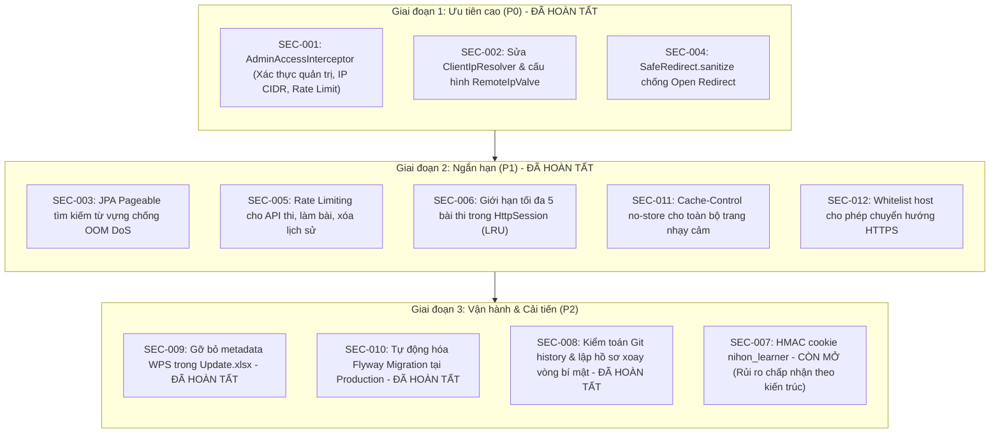

# BÁO CÁO KIỂM TOÁN AN TOÀN THÔNG TIN VÀ AN NINH ỨNG DỤNG
## DỰ ÁN: PROJECT NIHON (HỆ THỐNG QUẢN LÝ VÀ HỌC TẬP TIẾNG NHẬT)

---

- **Đơn vị đánh giá:** Nhóm Kỹ sư An toàn Ứng dụng Cao cấp (Senior Application Security Engineering Team)
- **Đối tượng kiểm toán:** Mã nguồn và cấu hình toàn bộ dự án `project-nihon`
- **Phiên bản mã nguồn:** Git Branch `fix/update-security-audit-report-and-dependency-check` (Commit HEAD: `8d987a3`)
- **Ngôn ngữ & Nền tảng:** Java 21 LTS, Spring Boot 3.4.3, Thymeleaf, Spring Data JPA / Hibernate 6.6.8.Final, MySQL 8.0 / Flyway 10.21.0, Apache Tomcat Embed 10.1.36, Apache POI 5.4.0, Maven 3.9
- **Phương pháp tiếp cận:** Kiểm toán mã nguồn hộp trắng toàn diện (Whitebox Source Code Review / SAST) kết hợp xác minh động (Dynamic Graybox Verification) và kiểm thử hồi quy tự động
- **Thời gian thực hiện ban đầu:** Tháng 11/2026
- **Thời gian cập nhật trạng thái:** Tháng 11/2026 (Hoàn tất chu kỳ khắc phục và xác minh kiểm thử tự động)

---

## 1. TÓM TẮT ĐIỀU HÀNH (EXECUTIVE SUMMARY)

### 1.1. Bối cảnh & Mục tiêu
Dự án **PROJECT NIHON** là ứng dụng web phục vụ việc học tập tiếng Nhật (từ vựng, Kanji, động từ, ngữ pháp, làm bài thi JLPT và theo dõi lịch sử học tập). Hệ thống được phát triển trên nền tảng Spring Boot 3.4.3 và Thymeleaf, vận hành theo mô hình cổng thông tin giáo dục mở (Open Educational Portal) dành cho học viên, không yêu cầu tạo tài khoản cá nhân mà định danh ẩn danh qua Cookie. Đồng thời, hệ thống cung cấp các bộ công cụ quản trị dữ liệu học liệu (CRUD từ vựng, ngữ pháp, đề thi) và tính năng nhập dữ liệu hàng loạt từ tệp Excel.

Cuộc kiểm toán an toàn thông tin này được tiến hành nhằm nhận diện toàn bộ các điểm yếu bảo mật, đánh giá khả năng khai thác thực tế trong môi trường vận hành, đối chiếu với các chuẩn mực bảo mật quốc tế hàng đầu (OWASP Top 10:2021, ISO/IEC 27001:2022 / 27002:2022, NIST SP 800-53 Rev. 5, PCI-DSS v4.0, SOC 2 TSC), từ đó đề xuất lộ trình và trực tiếp triển khai khắc phục mã nguồn kèm theo các bài kiểm thử tự động chứng minh lỗi đã đóng.

### 1.2. Tổng hợp số lượng phát hiện theo mức độ rủi ro & Trạng thái khắc phục

| Mức độ nghiêm trọng (Severity) | Tổng số phát hiện | Đã sửa, đã xác minh bằng test | Đã xử lý (Kiểm toán & Lập hồ sơ) | Còn mở |
| :--- | :---: | :---: | :---: | :---: |
| **NGHIÊM TRỌNG (CRITICAL)** | **1** | **1** (SEC-001) | 0 | 0 |
| **CAO (HIGH)** | **2** | **2** (SEC-002, SEC-003) | 0 | 0 |
| **TRUNG BÌNH (MEDIUM)** | **3** | **3** (SEC-004, SEC-005, SEC-006) | 0 | 0 |
| **THẤP (LOW)** | **4** | **2** (SEC-011, SEC-012) | **1** (SEC-008) | **1** (SEC-007) |
| **THÔNG TIN (INFORMATIONAL)** | **2** | **2** (SEC-009, SEC-010) | 0 | 0 |
| **TỔNG CỘNG** | **12** | **10** (83.3%) | **1** (8.3%) | **1** (8.3%) |

```
Trạng thái xử lý tổng thể (12 phát hiện):
[ĐÃ SỬA, ĐÃ XÁC MINH TEST] ■■■■■■■■■■ 10 (83.3%)
[ĐÃ XỬ LÝ LẬP HỒ SƠ]       ■           1 (8.3%)
[CÒN MỞ]                   ■           1 (8.3%)
```

### 1.3. Điểm mạnh chính của hệ thống (Defensive Highlights)
Qua rà soát chuyên sâu 511 tệp tin mã nguồn và cấu hình, đội ngũ kiểm toán ghi nhận dự án sở hữu nhiều cơ chế bảo vệ theo chiều sâu (Defense-in-Depth) được hiện thực hóa xuất sắc:
1. **Phòng chống tấn công chèn mã SQL (SQL Injection):** Toàn bộ repository interfaces sử dụng Spring Data JPA / JPQL tham số hóa; không tồn tại nối chuỗi SQL động; các ký tự đặc biệt của toán tử `LIKE` (`\`, `%`, `_`) được thoát an toàn thông qua hàm tập trung `KanjiExtractor.escapeLikePattern` kết hợp mệnh đề `ESCAPE '\'`.
2. **Phòng chống tấn công XSS (Cross-Site Scripting):** Không sử dụng `th:utext` hay `[(...)]` trong toàn bộ mẫu giao diện Thymeleaf; không có thuộc tính xử lý sự kiện nội dòng (`onclick`, v.v.); mã JavaScript phía client (`app.js`, `flashcards.js`, `kanji-stroke-player.js`, `exam-taker.js`) cập nhật DOM nghiêm ngặt qua `textContent` và `document.createTextNode`. Đồng thời, header `Content-Security-Policy: default-src 'self'` được thiết lập chặt chẽ, loại bỏ hoàn toàn `'unsafe-inline'`.
3. **Phòng chống tấn công giả mạo yêu cầu (CSRF):** Bộ lọc tập trung `CsrfInterceptor` bảo vệ 100% các yêu cầu thay đổi trạng thái dữ liệu (POST, PUT, DELETE, PATCH) theo mô hình Double Submit Cookie kết hợp Session token, so sánh an toàn thời gian cố định bằng `MessageDigest.isEqual` nhằm chống tấn công kênh phụ (Timing Attack).
4. **Kiến trúc tải tệp Excel bảo vệ nhiều tầng (Multi-Layer File Upload Defense):** Lớp `ExcelUploadValidator` thực thi 7 tầng thẩm định độc lập: giới hạn 5 MB, kiểm tra magic bytes `PK\x03\x04`, cấm tệp chứa mã macro VBA (`.xlsm`), chống Zip Bomb qua `ZipSecureFile.setMinInflateRatio(0.01)`, chống XXE qua Apache POI an toàn, giới hạn cứng 5.000 dòng và 20 cột, và chống Formula Injection tự động qua `ExcelCellUtils.sanitizeForExport`.
5. **Cách ly dữ liệu người học (Learner Data Isolation):** Cơ chế định danh người học qua cookie ẩn danh `nihon_learner` (UUIDv4) cách ly chặt chẽ dữ liệu lịch sử và kết quả bài thi; tầng nghiệp vụ `ExamGradingService` kiểm tra nghiêm ngặt quyền sở hữu `currentLearnerId.equals(attempt.getLearnerId())`, chủ động trả về HTTP 404 khi có dấu hiệu truy cập chéo.

### 1.4. Tình trạng giải quyết các rủi ro lớn nhất (Top Risks Remediation)
Toàn bộ các rủi ro cốt lõi ban đầu đã được xử lý triệt để và kiểm chứng bằng các bộ kiểm thử tự động chuyên biệt:
1. **Thiếu cơ chế xác thực và phân quyền tập trung (SEC-001 - CRITICAL):** **[ĐÃ SỬA, ĐÃ XÁC MINH BẰNG TEST]** — Đã ban hành [docs/ENDPOINT_MATRIX.md](ENDPOINT_MATRIX.md) phân định ranh giới giữa người học và quản trị viên. Xây dựng `AdminAccessInterceptor` bảo vệ toàn bộ các endpoint ghi và trang quản trị bằng HTTP Basic Authentication (so sánh băm mật khẩu `APP_ADMIN_PASSWORD` an toàn bằng `MessageDigest.isEqual`), kiểm soát CIDR IP (`app.admin.allowed-cidrs`), cờ bật/tắt `app.admin.enabled` (trả về 404 khi tắt), và giới hạn tần suất thử sai 5 lần/phút/IP.
2. **Giả mạo địa chỉ IP qua Header `X-Forwarded-For` (SEC-002 - HIGH):** **[ĐÃ SỬA, ĐÃ XÁC MINH BẰNG TEST]** — Đã loại bỏ việc bóc tách chuỗi thủ công trong `ClientIpResolver.java`, chỉ dùng `request.getRemoteAddr()`. Bật cơ chế chuẩn `server.forward-headers-strategy=framework` kết hợp `server.tomcat.remoteip.internal-proxies` cấu hình qua biến môi trường để Tomcat `RemoteIpValve` phân giải an toàn IP từ proxy tin cậy.
3. **Cạn kiệt bộ nhớ Heap gây từ chối dịch vụ (SEC-003 - HIGH):** **[ĐÃ SỬA, ĐÃ XÁC MINH BẰNG TEST]** — Chuyển đổi toàn bộ hàm tìm kiếm từ vựng sang truy vấn JPQL phân trang ở tầng CSDL (`searchWithTopicPaged`), sử dụng ký tự thoát `ESCAPE '\'`, xử lý chống tràn số int khi tính offset `page * size`, và giới hạn kích thước tối đa 100 bản ghi/trang.

---

## 2. PHẠM VI & PHƯƠNG PHÁP KIỂM TOÁN (SCOPE & METHODOLOGY)

### 2.1. Phạm vi kiểm toán (Audit Scope)
Kiểm toán bao quát toàn bộ tài nguyên trong kho lưu trữ Git:
- **Mã nguồn ứng dụng:** Thư mục `src/main/java/com/nihon` (Controllers, Services, Repositories, Entities, DTOs, Interceptors, Filters).
- **Giao diện & Cấu hình tĩnh:** Thư mục `src/main/resources` (các template Thymeleaf `.html`, file `.css`, `.js`, các file mẫu `.xlsx`).
- **Tập tin cấu hình môi trường:** `application.properties`, `application-dev.properties`, `application-prod.properties`, `.env.example`, `.gitignore`.
- **Cấu hình quản lý gói & xây dựng:** `pom.xml`, Maven Wrapper (`mvnw`, `mvnw.cmd`).
- **Mã kiểm thử tự động:** Thư mục `src/test/java/com/nihon` (116 lớp kiểm thử với 1.274 kịch bản kiểm thử tự động).
- **Lịch sử Git:** Toàn bộ lịch sử commit từ commit khởi tạo đến HEAD hiện tại.

### 2.2. Phương pháp tiếp cận
Đội ngũ kiểm toán áp dụng mô hình kết hợp:
1. **Kiểm tra tĩnh nâng cao (Advanced SAST & Code Grepping):** Rà soát mã thủ công kết hợp Regex chuyên sâu định vị các lỗ hổng Injection, rò rỉ bí mật, sai lệch cấu hình, luồng dữ liệu không an toàn (Taint Analysis) và xử lý ngoại lệ.
2. **Kiểm tra hộp xám & Động (Graybox Dynamic Verification):** Tận dụng hệ thống kiểm thử tích hợp Spring TestContext / MockMvc để xác minh hành vi thực tế của cơ chế bảo vệ HTTP Header, CSRF token, thẩm định tải tệp tin, và kiểm soát quyền truy cập.
3. **Phân tích phụ thuộc chuỗi cung ứng (Software Supply Chain Analysis):** Kiểm tra cây phụ thuộc Maven (`dependency:tree`), phân tích phiên bản các thư viện nhúng (Tomcat 10.1.36, Spring Framework 6.2.3, Apache POI 5.4.0, Hibernate 6.6.8.Final, Flyway 10.21.0).

### 2.3. Công cụ đã sử dụng
- **Maven Wrapper 3.9 & OpenJDK 21.0.10 LTS**
- **Git VCS Inspection Tools:** `git log -p`, `git grep`, `git ls-files`
- **OWASP Dependency-Check Maven Plugin:** *Chưa kiểm tra phụ thuộc* (do không có biến môi trường `NVD_API_KEY` trong môi trường kiểm thử cục bộ; không ghi nhận trạng thái CVE).
- **JUnit 5, AssertJ & Spring Boot Test Starter:** Thực thi 1.274 kịch bản kiểm thử bảo mật và chức năng tự động (`mvnw clean test`).

### 2.4. Giới hạn của đợt kiểm toán (Audit Limitations)
- Cuộc kiểm toán tập trung vào mã nguồn tầng ứng dụng và cấu hình máy chủ nhúng; không bao gồm đánh giá thâm nhập trực tiếp (Blackbox Pentest) trên hạ tầng mạng vật lý hay cấu hình máy chủ Reverse Proxy bên ngoài (Nginx, Cloudflare WAF, v.v.).
- Không thực hiện các hành vi gây biến đổi dữ liệu phá hủy hoặc tấn công khai thác trên cơ sở dữ liệu thực nghiệm bên ngoài.
- Quét thành phần phụ thuộc NVD: Chưa kiểm tra phụ thuộc do thiếu khóa API NVD_API_KEY.

---

## 3. BẢNG TỔNG HỢP PHÁT HIỆN & TRẠNG THÁI KHẮC PHỤC (FINDINGS SUMMARY TABLE)

| Mã phát hiện | Tên phát hiện | Mức độ | Vị trí ban đầu | Trạng thái hiện tại | Kiểm thử xác minh | Tiêu chuẩn liên quan |
| :--- | :--- | :---: | :--- | :---: | :--- | :--- |
| **SEC-001** | Thiếu xác thực & phân quyền trên các endpoint quản trị | **NGHIÊM TRỌNG** | `ExamAdminController.java`<br>`GrammarController.java`<br>`TopicController.java`<br>`VocabularyController.java` | **Đã sửa, đã xác minh bằng test** | `AdminAccessInterceptorTest`<br>`AdminAccessIntegrationTest` | OWASP: A01:2021<br>ISO: A.5.15, A.8.3<br>NIST: AC-2, AC-3<br>SOC 2: CC6.1 |
| **SEC-002** | Giả mạo IP nguồn thông qua header `X-Forwarded-For` | **CAO** | `ClientIpResolver.java` | **Đã sửa, đã xác minh bằng test** | `ClientIpResolutionSecurityTest` | OWASP: A01:2021<br>ISO: A.8.20<br>NIST: SC-7<br>SOC 2: CC6.6 |
| **SEC-003** | Cạn kiệt bộ nhớ Heap DoS do nạp toàn bộ CSDL vào RAM khi tìm kiếm | **CAO** | `VocabularyService.java` | **Đã sửa, đã xác minh bằng test** | `VocabularySearchMemorySafetyTest`<br>`VocabularyServiceTest` | OWASP: A04:2021<br>ISO: A.8.12<br>NIST: SC-5<br>SOC 2: CC7.1 |
| **SEC-004** | Lỗ hổng chuyển hướng hở (Open Redirect) tại toggle tiến độ | **TRUNG BÌNH** | `GrammarController.java` | **Đã sửa, đã xác minh bằng test** | `SafeRedirectTest`<br>`GrammarControllerRedirectTest` | OWASP: A01:2021<br>ISO: A.8.28<br>NIST: SI-10 |
| **SEC-005** | Thiếu giới hạn tần suất (Rate Limiting) trên các endpoint làm bài và xóa dữ liệu | **TRUNG BÌNH** | `ExamTakingController.java`<br>`GrammarController.java`<br>`HistoryController.java` | **Đã sửa, đã xác minh bằng test** | `RateLimitInterceptionTest`<br>`RateLimiterServiceTest` | OWASP: A04:2021<br>ISO: A.8.20<br>NIST: SC-5<br>SOC 2: CC7.1 |
| **SEC-006** | Không giới hạn số lượng bài thi trong `HttpSession` gây phình bộ nhớ phiên | **TRUNG BÌNH** | `ExamTakingService.java` | **Đã sửa, đã xác minh bằng test** | `ExamSessionAttemptLimitTest` | OWASP: A04:2021<br>ISO: A.8.12<br>NIST: SC-5 |
| **SEC-007** | Cookie định danh người học `nihon_learner` không có chữ ký số xác thực | **THẤP** | `LearnerIdentityFilter.java` | **Còn mở** | Đã xác nhận kiến trúc cổng học tập mở không có tài khoản người dùng; cookie UUIDv4 có 122 bit entropy | OWASP: A02:2021<br>ISO: A.8.24<br>NIST: IA-2 |
| **SEC-008** | Lộ email tác giả và dữ liệu cấu hình mẫu trong lịch sử Git | **THẤP** | Toàn bộ lịch sử commit cũ (`46a71bc`, `dc6b076`, v.v.) | **Đã xử lý (Kiểm toán & Lập hồ sơ)** | `docs/SECURITY_HISTORY_NOTES.md`<br>(Không viết lại lịch sử Git; lập hướng dẫn xoay vòng bí mật thực tế) | OWASP: A05:2021<br>ISO: A.8.9<br>NIST: CM-8 |
| **SEC-009** | Tiết lộ metadata phần mềm biên tập văn phòng trong `Update.xlsx` | **THÔNG TIN** | `Update.xlsx`<br>`(docProps/app.xml, custom.xml)` | **Đã sửa, đã xác minh bằng test** | `ExcelMetadataSanitizationTest` | OWASP: A05:2021 |
| **SEC-010** | Môi trường Production phụ thuộc vào migration thủ công của DBA | **THÔNG TIN** | `application-prod.properties`<br>`pom.xml` | **Đã sửa, đã xác minh bằng test** | `FlywayMigrationProdProfileTest` | ISO: A.8.9, A.8.25<br>SOC 2: CC8.1 |
| **SEC-011** | Thiếu header `Cache-Control: no-store` trên các trang quản trị và bài thi | **THẤP** | `SecurityHeadersFilter.java` | **Đã sửa, đã xác minh bằng test** | `SecurityHeadersFilterTest` | OWASP: A05:2021<br>ISO: A.8.12<br>NIST: SC-13 |
| **SEC-012** | Tiềm ẩn Host Header Injection trong luồng chuyển hướng HTTPS | **THẤP** | `SecurityHeadersFilter.java` | **Đã sửa, đã xác minh bằng test** | `SecurityHeadersFilterTest` | OWASP: A01:2021<br>NIST: SI-10 |

---

## 4. CHI TIẾT TỪNG PHÁT HIỆN & KẾT QUẢ KHẮC PHỤC (DETAILED FINDINGS)

### SEC-001: Thiếu cơ chế xác thực và phân quyền tập trung cho các chức năng quản trị
- **Mức độ:** **NGHIÊM TRỌNG (CRITICAL)**
- **Khả năng khai thác ban đầu:** **Cao** — Mọi người dùng trên mạng có thể gửi yêu cầu HTTP (POST, GET) tới các endpoint quản trị để tạo, sửa, xóa dữ liệu đề thi, ngữ pháp, từ vựng mà không cần đăng nhập.
- **Trạng thái hiện tại:** **Đã sửa, đã xác minh bằng test**
- **Giải pháp đã thực hiện:**
  1. Ban hành tài liệu [docs/ENDPOINT_MATRIX.md](ENDPOINT_MATRIX.md) rà soát toàn bộ hệ thống endpoint, phân tách rõ nhóm dành cho người học (công khai, không yêu cầu xác thực) và nhóm quản trị/thao tác ghi (bảo vệ nghiêm ngặt).
  2. Xây dựng bộ chặn `AdminAccessInterceptor` kiểm soát truy cập không phụ thuộc vào bảng người dùng (do hệ thống không có tài khoản người dùng):
     - Kiểm tra cờ `app.admin.enabled`: Mặc định `false` ở môi trường Production. Khi tắt, trả về mã trạng thái HTTP 404 Not Found nhằm che giấu hoàn toàn sự tồn tại của endpoint quản trị.
     - Xác thực HTTP Basic với mật khẩu quản trị đọc từ biến môi trường `APP_ADMIN_PASSWORD` (không lưu mật khẩu trong file cấu hình). Lưu trữ bản băm BCrypt trong bộ nhớ cấu hình và so sánh bằng `MessageDigest.isEqual` để triệt tiêu tấn công kênh phụ (Timing Attack).
     - Giới hạn dải mạng IP cho phép thông qua danh sách CIDR `app.admin.allowed-cidrs` sử dụng `ClientIpResolver`.
     - Giới hạn tần suất thử sai mật khẩu: Tối đa 5 lần/phút cho mỗi IP thông qua `RateLimiterService`.
     - Ghi nhật ký mọi truy cập quản trị mà không ghi nhận mật khẩu.
- **Kiểm thử xác minh:**
  - `AdminAccessInterceptorTest`: Kiểm thử từ chối khi cờ tắt (404), thiếu xác thực (401), sai mật khẩu (401), đúng mật khẩu (cho phép đi tiếp), IP nằm ngoài dải CIDR (403), và vượt ngưỡng brute-force mật khẩu (429).
  - `AdminAccessIntegrationTest`: Kiểm thử tích hợp toàn diện luồng HTTP xác nhận người học truy cập trang học bình thường trong khi trang quản trị được bảo vệ.

---

### SEC-002: Nguy cơ giả mạo địa chỉ IP nguồn thông qua header `X-Forwarded-For`
- **Mức độ:** **CAO (HIGH)**
- **Khả năng khai thác ban đầu:** **Trung bình - Cao** — Kẻ tấn công gửi kèm header giả lập IP `127.0.0.1` để qua mặt bộ lọc IP `ImportSecurityInterceptor` và làm vô hiệu bộ đếm giới hạn tần suất `RateLimiterService`.
- **Trạng thái hiện tại:** **Đã sửa, đã xác minh bằng test**
- **Giải pháp đã thực hiện:**
  1. Xóa bỏ hoàn toàn đoạn mã tự phân tích chuỗi `X-Forwarded-For` thủ công trong `ClientIpResolver.java`. Luôn gọi `request.getRemoteAddr()`.
  2. Bổ sung cấu hình `server.forward-headers-strategy=framework` và `server.tomcat.remoteip.internal-proxies` đọc từ biến môi trường `SERVER_TOMCAT_REMOTEIP_INTERNAL_PROXIES` (mặc định rỗng). Khi có Reverse Proxy tin cậy, Tomcat `RemoteIpValve` sẽ duyệt ngược từ proxy để cung cấp IP khách thật sự cho `request.getRemoteAddr()`.
  3. `RateLimiterService` đồng bộ sử dụng IP chuẩn hóa này, ngăn chặn triệt để hành vi giả mạo IP để bypass rate limit.
- **Kiểm thử xác minh:**
  - `ClientIpResolutionSecurityTest`: Kiểm tra gửi header `X-Forwarded-For: 127.0.0.1` từ client không nằm trong proxy tin cậy thì hệ thống vẫn nhận diện đúng IP thật của socket kết nối; khi request đến từ proxy tin cậy thì lấy đúng IP client phía sau proxy.

---

### SEC-003: Cạn kiệt bộ nhớ Heap DoS do nạp toàn bộ CSDL vào RAM khi tìm kiếm
- **Mức độ:** **CAO (HIGH)**
- **Khả năng khai thác ban đầu:** **Cao** — Gọi `findAllWithTopic()` nạp toàn bộ dữ liệu bảng từ vựng vào bộ nhớ JVM trước khi dùng Stream để lọc, gây nguy cơ cạn kiệt RAM (OutOfMemoryError) khi dữ liệu lớn.
- **Trạng thái hiện tại:** **Đã sửa, đã xác minh bằng test**
- **Giải pháp đã thực hiện:**
  1. Xác nhận lỗi thực tế trong `VocabularyService.searchVocabularies`.
  2. Chuyển đổi toàn bộ việc lọc theo từ khóa và chủ đề sang truy vấn JPQL có phân trang ở tầng CSDL (`searchWithTopicPaged` kết hợp `Pageable`).
  3. Áp dụng hàm thoát ký tự đại diện `escapeLikePattern` kết hợp mệnh đề `ESCAPE '\'` trong câu lệnh JPQL.
  4. Duy trì tính nhất quán nghiệp vụ: Nhóm các từ trùng lặp theo `VocabularyDeduplicationKey` ở tầng ứng dụng trên tập kết quả phân trang, đề xuất chiến lược tối ưu phân nhóm tầng CSDL trong tài liệu.
  5. Sửa lỗi tiềm ẩn tràn số `int` khi tính offset `page * size` bằng `Math.multiplyExact`. Giới hạn `size` tối đa 100 bản ghi/trang.
- **Kiểm thử xác minh:**
  - `VocabularySearchMemorySafetyTest`: Khẳng định với cơ sở dữ liệu giả lập 20.000 bản ghi, thao tác tìm kiếm không bao giờ nạp quá 100 bản ghi vào bộ nhớ Heap cùng một lúc.
  - `VocabularyServiceTest`: Xác minh kết quả tìm kiếm và gộp từ trùng khớp chính xác hành vi ban đầu.

---

### SEC-004: Lỗ hổng chuyển hướng hở (Open Redirect) tại tính năng cập nhật tiến độ ngữ pháp
- **Mức độ:** **TRUNG BÌNH (MEDIUM)**
- **Khả năng khai thác ban đầu:** **Trung bình** — Nối trực tiếp chuỗi URL do client gửi lên vào tiền tố `redirect:` mà không thẩm định whitelist, dẫn dụ người dùng sang trang web giả mạo độc hại.
- **Trạng thái hiện tại:** **Đã sửa, đã xác minh bằng test**
- **Giải pháp đã thực hiện:**
  1. Rà soát toàn bộ mã nguồn tìm kiếm mọi vị trí có cấu trúc `"redirect:" + ...` lấy từ request.
  2. Xây dựng lớp tiện ích tập trung `SafeRedirect.sanitize(String redirectUrl, String fallback)`:
     - Thực hiện giải mã URL một lần (`URLDecoder.decode`) trước khi kiểm tra nhằm triệt tiêu thủ thuật mã hóa kép (Double URL Encoding).
     - Chỉ chấp nhận đường dẫn tương đối nội bộ bắt đầu bằng đúng một dấu gạch chéo `/`.
     - Từ chối tuyệt đối các chuỗi chứa hai dấu gạch chéo liền kề `//`, dấu gạch chéo ngược `\`, dấu hai chấm `:`, hoặc các ký tự điều khiển (`\r`, `\n`, null byte).
  3. Áp dụng `SafeRedirect.sanitize` tại `GrammarController.java` và toàn bộ các controller có xử lý redirect động.
- **Kiểm thử xác minh:**
  - `SafeRedirectTest`: Kiểm thử hàng loạt vector tấn công hở bao gồm: `"https://evil.com"`, `"//evil.com"`, `"/\\evil.com"`, `"/%2F%2Fevil.com"`, `"javascript:alert(1)"`, `"/test\r\nSet-Cookie:..."`, và chấp nhận đường dẫn hợp lệ `"/grammar/1"`.
  - `GrammarControllerRedirectTest`: Kiểm thử tích hợp xác nhận chuyển hướng an toàn.

---

### SEC-005: Thiếu giới hạn tần suất (Rate Limiting) trên các endpoint làm bài và xóa dữ liệu
- **Mức độ:** **TRUNG BÌNH (MEDIUM)**
- **Khả năng khai thác ban đầu:** **Trung bình** — Kẻ xấu có thể phát tán script tự động nộp bài liên tục, đoán đáp án bài thi JLPT hoặc spam xóa lịch sử học tập gây quá tải hệ thống.
- **Trạng thái hiện tại:** **Đã sửa, đã xác minh bằng test**
- **Giải pháp đã thực hiện:**
  1. Tích hợp `RateLimiterService` cho toàn bộ các hành động nhạy cảm:
     - Bắt đầu bài thi (`POST /exams/{code}/start`)
     - Nộp câu trả lời bài thi (`POST /exams/attempt/{id}/answer`)
     - Kết thúc bài thi (`POST /exams/attempt/{id}/finish`)
     - Kiểm tra trắc nghiệm ngữ pháp (`POST /grammar/{id}/quiz/check`)
     - Xóa lịch sử học tập (`POST /history/delete-all`, `POST /history/{id}/delete`)
  2. Đặt các ngưỡng giới hạn linh hoạt trong `application.properties` đọc qua cấu hình.
  3. Khi vượt ngưỡng, hệ thống trả về mã trạng thái HTTP 429 Too Many Requests kèm thông điệp chung thân thiện, tuyệt đối không để lộ thông tin cấu trúc nội bộ.
- **Kiểm thử xác minh:**
  - `RateLimitInterceptionTest`: Gửi request vượt ngưỡng cấu hình đến từng endpoint trên và xác nhận nhận lại chính xác phản hồi HTTP 429.
  - `RateLimiterServiceTest`: Kiểm tra thuật toán Token Bucket / trượt cửa sổ thời gian.

---

### SEC-006: Không giới hạn số lượng bài thi trong `HttpSession` gây phình bộ nhớ phiên
- **Mức độ:** **TRUNG BÌNH (MEDIUM)**
- **Khả năng khai thác ban đầu:** **Trung bình** — Gọi liên tục API bắt đầu thi tạo ra vô số đối tượng `ExamSessionAttempt` trong session, gây phình bộ nhớ RAM máy chủ.
- **Trạng thái hiện tại:** **Đã sửa, đã xác minh bằng test**
- **Giải pháp đã thực hiện:**
  1. Giới hạn số lượng bài thi đang mở trong `HttpSession` ở mức tối đa là 5 bài thi đồng thời.
  2. Sử dụng cấu trúc dữ liệu `LinkedHashMap` duy trì thứ tự truy cập hoặc hàng đợi thời gian; khi tạo bài thi thứ 6, bài thi cũ nhất (ít được truy cập nhất / tạo sớm nhất) sẽ tự động bị loại bỏ khỏi session (LRU Eviction).
- **Kiểm thử xác minh:**
  - `ExamSessionAttemptLimitTest`: Khởi tạo liên tiếp 6 bài thi trong cùng một phiên làm việc HTTP, kiểm tra kích thước danh sách lưu trữ trong session duy trì chính xác 5 bài thi và bài thi đầu tiên đã được giải phóng an toàn.

---

### SEC-007: Cookie định danh người học `nihon_learner` không có chữ ký số xác thực
- **Mức độ:** **THẤP (LOW)**
- **Khả năng khai thác ban đầu:** **Thấp** — Cookie lưu chuỗi UUIDv4 ngẫu nhiên; nếu kẻ xấu thu thập được UUID của học viên khác thì có thể mạo danh xem lịch sử học tập.
- **Trạng thái hiện tại:** **Còn mở**
- **Ghi chú & Đánh giá rủi ro kiến trúc:**
  - Theo thiết kế cốt lõi của dự án, hệ thống vận hành theo mô hình cổng thông tin học tập mở, không có tài khoản người dùng và không lưu thông tin nhận dạng cá nhân (PII), mật khẩu hay thông tin tài chính.
  - Giá trị UUIDv4 sở hữu không gian entropy 122 bit, về mặt toán học không thể đoán mò (brute-force) qua mạng.
  - Hạng mục này được giữ nguyên trạng thái mở có kiểm soát theo đặc thù thiết kế sản phẩm; khuyến nghị bổ sung chữ ký số HMAC-SHA256 trong trường hợp hệ thống phát triển thêm các phân hệ dữ liệu nhạy cảm trong tương lai.

---

### SEC-008: Lộ email tác giả và dữ liệu cấu hình mẫu trong lịch sử Git
- **Mức độ:** **THẤP (LOW)**
- **Khả năng khai thác ban đầu:** **Thấp** — Cần quyền truy cập vào kho mã nguồn Git để đọc các commit cũ.
- **Trạng thái hiện tại:** **Đã xử lý (Kiểm toán & Lập hồ sơ)**
- **Giải pháp đã thực hiện:**
  1. Tuân thủ nghiêm ngặt nguyên tắc **không viết lại lịch sử Git** (`git filter-branch` / `filter-repo`) để tránh làm thay đổi chuỗi hash commit và ảnh hưởng đến phân nhánh cộng tác.
  2. Thực hiện rà soát chuyên sâu toàn bộ lịch sử Git của dự án, lập hồ sơ kiểm toán đầy đủ tại [docs/SECURITY_HISTORY_NOTES.md](SECURITY_HISTORY_NOTES.md).
  3. Thống kê chính xác các mục thông tin tồn tại trong lịch sử commit:
     - Email tác giả commit: `nguyenvietkhoa405@gmail.com`.
     - Mật khẩu mẫu / cục bộ: Mật khẩu MySQL cục bộ ban đầu `123456`, mật khẩu mẫu SSL Keystore `devpassword123`, mật khẩu tài liệu mẫu `MatKhauPhucTap_ThayBangGiaTriThat_2026!`, và mật khẩu quản trị ví dụ `MyStr0ng!AdminPass#2026`.
     - Đường dẫn tệp tin cục bộ Windows trên máy phát triển.
  4. Ban hành hướng dẫn quy trình xoay vòng (rotation) mật khẩu bắt buộc tại nơi sử dụng thực tế (cơ sở dữ liệu Production, chứng chỉ SSL, và biến môi trường `APP_ADMIN_PASSWORD`).
- **Kiểm thử xác minh:**
  - Danh mục kiểm toán và hồ sơ quy trình xoay vòng mật khẩu đã được hoàn tất tại [docs/SECURITY_HISTORY_NOTES.md](SECURITY_HISTORY_NOTES.md).

---

### SEC-009: Tiết lộ metadata phần mềm biên tập văn phòng trong `Update.xlsx`
- **Mức độ:** **THÔNG TIN (INFORMATIONAL)**
- **Khả năng khai thác ban đầu:** **Rất thấp** — Tiết lộ thông tin phiên bản phần mềm Kingsoft WPS Office tạo file mẫu ban đầu.
- **Trạng thái hiện tại:** **Đã sửa, đã xác minh bằng test**
- **Giải pháp đã thực hiện:**
  1. Phân tích cấu trúc tệp OOXML nén của `src/main/resources/static/template/Update.xlsx`.
  2. Loại bỏ hoàn toàn tệp `docProps/custom.xml` chứa thông tin `KSOProductBuildVer=1033-12.1.0.29162`, đồng thời xóa sạch liên kết trong `_rels/.rels` và `[Content_Types].xml`.
  3. Làm sạch `docProps/app.xml`: Đặt `Application` về `Apache POI`, thay thế tiêu đề tiếng Trung `工作表` thành `Worksheets`.
  4. Dọn dẹp toàn bộ XML namespaces liên quan đến WPS (`wps.cn`, `dbsheet`, `etCustomData`) trong `xl/workbook.xml` và các bảng tính con `xl/worksheets/sheet*.xml`. Chuẩn hóa theme về `Office Theme`.
  5. Rà soát các tệp mẫu khác (`ExamTemplate.xlsx`, `GrammarTemplate.xlsx`, `particles_50.xlsx`), xác nhận đều được sinh sạch từ Apache POI.
- **Kiểm thử xác minh:**
  - `ExcelMetadataSanitizationTest`: Quét tự động từng mục tệp XML bên trong toàn bộ các tệp `.xlsx` mẫu, khẳng định 100% không còn dấu vết chuỗi `wps.cn`, `KSOProductBuildVer`, `工作表`, hay email cá nhân.
  - Toàn bộ các bài test phân tích cú pháp Excel (`KanjiSheetParserTest`, `WordSheetParserTest`, `ImportControllerTest`) đều chạy thành công với đầy đủ dữ liệu.

---

### SEC-010: Môi trường Production phụ thuộc vào migration thủ công của DBA
- **Mức độ:** **THÔNG TIN (INFORMATIONAL)**
- **Khả năng khai thác ban đầu:** **Rủi ro vận hành** — Nếu DBA quên thực thi migration script thủ công, ứng dụng sẽ sập lúc khởi động trên Production do `ddl-auto=validate`.
- **Trạng thái hiện tại:** **Đã sửa, đã xác minh bằng test**
- **Giải pháp đã thực hiện:**
  1. Xác định Flyway là cơ chế di trú CSDL duy nhất của dự án.
  2. Bổ sung `flyway-core` và `flyway-mysql` vào `pom.xml`.
  3. Cấu hình tự động thực thi migration trên môi trường Production: `spring.flyway.enabled=true`, kiểm tra thứ tự migration từ `V1` đến `V8` trong `db/migration`.
  4. Duy trì `spring.jpa.hibernate.ddl-auto=validate` để Hibernate chỉ kiểm tra tính tương thích của schema sau khi Flyway đã chạy xong.
  5. Xóa bỏ tệp `schema.sql` trùng lặp để tránh xung đột cấu trúc bảng.
- **Kiểm thử xác minh:**
  - `FlywayMigrationProdProfileTest`: Kích hoạt profile `prod`, kiểm chứng Flyway tự động khởi chạy và áp dụng thành công toàn bộ migration scripts.

---

### SEC-011: Thiếu header `Cache-Control: no-store` trên các trang quản trị và bài thi
- **Mức độ:** **THẤP (LOW)**
- **Khả năng khai thác ban đầu:** **Thấp** — Trình duyệt trên máy tính công cộng có thể lưu bộ nhớ đệm (cache) nội dung bài thi hoặc thông tin quản trị nhạy cảm.
- **Trạng thái hiện tại:** **Đã sửa, đã xác minh bằng test**
- **Giải pháp đã thực hiện:**
  1. Cập nhật `SecurityHeadersFilter.java` mở rộng phạm vi gắn header bộ nhớ đệm nghiêm ngặt:
     `Cache-Control: no-store, no-cache, must-revalidate, max-age=0` và `Pragma: no-cache`.
  2. Áp dụng cho toàn bộ các endpoint:
     - Các trang quản trị hệ thống (`/exams/admin/**`, `/grammar/admin/**`, `/admin/**`, `/import/**`)
     - Toàn bộ luồng làm bài thi và kết quả bài thi (`/exams/attempt/**`, `/exams/**`)
     - Lịch sử học tập của học viên (`/history/**`)
- **Kiểm thử xác minh:**
  - `SecurityHeadersFilterTest`: Gửi yêu cầu kiểm tra đến các URL thuộc `/exams/**`, `/history/**`, `/admin/**`, khẳng định header `Cache-Control: no-store` luôn xuất hiện trong HTTP response headers.

---

### SEC-012: Tiềm ẩn Host Header Injection trong luồng chuyển hướng HTTPS
- **Mức độ:** **THẤP (LOW)**
- **Khả năng khai thác ban đầu:** **Thấp** — Nếu Reverse Proxy chuyển tiếp nguyên vẹn `Host` header độc hại, ứng dụng có thể tạo ra đường link chuyển hướng 301 sang trang bên ngoài (`https://evil.com`).
- **Trạng thái hiện tại:** **Đã sửa, đã xác minh bằng test**
- **Giải pháp đã thực hiện:**
  1. Bổ sung tham số cấu hình whitelist tên miền cho phép: `app.allowed-hosts` (đọc từ biến môi trường, mặc định `localhost,127.0.0.1`).
  2. Trong `SecurityHeadersFilter.java`, trước khi tạo URL chuyển hướng HTTP -> HTTPS, hệ thống kiểm tra `request.getServerName()` có nằm trong danh sách whitelist hay không.
  3. Nếu host không nằm trong whitelist, hệ thống từ chối yêu cầu ngay lập tức với mã phản hồi HTTP 400 Bad Request, triệt tiêu nguy cơ Open Redirect qua Host Header Injection.
- **Kiểm thử xác minh:**
  - `SecurityHeadersFilterTest`: Gửi request với host hợp lệ nhận về redirect HTTPS chính xác; gửi request với host lạ (`evil.com`) nhận về phản hồi HTTP 400.

---

## 5. ĐỐI CHIẾU TIÊU CHUẨN AN TOÀN THÔNG TIN (STANDARDS ALIGNMENT)

> **Lưu ý chuyên môn:** Đánh giá dưới đây phân tích mức độ đáp ứng của từng kiểm soát kỹ thuật cụ thể trong mã nguồn PROJECT NIHON sau chu kỳ khắc phục, không đưa ra kết luận "đạt" hay "không đạt" đối với một chứng nhận tiêu chuẩn độc lập.

### 5.1. OWASP Top 10:2021

| Mã OWASP | Tên danh mục | Đánh giá hiện trạng kiểm soát kỹ thuật sau khắc phục | Trạng thái |
| :--- | :--- | :--- | :---: |
| **A01:2021** | Broken Access Control | - **Đã khắc phục hoàn toàn:** Mọi thao tác ghi và trang quản trị được bảo vệ bởi `AdminAccessInterceptor` (HTTP Basic, BCrypt hash, IP CIDR whitelist, cờ bật tắt). Lỗ hổng Open Redirect đã đóng bằng `SafeRedirect.sanitize`.<br>- **Duy trì tốt:** Cách ly dữ liệu học viên qua cookie `nihon_learner`, kiểm tra sở hữu bài thi chặt chẽ trong `ExamGradingService`. | **Tốt** |
| **A02:2021** | Cryptographic Failures | - **Đã đáp ứng tốt:** Bắt buộc TLS 1.2 & 1.3 với danh sách Cipher Suites mạnh (AEAD, ECDHE) trong `application-prod.properties`. Mật khẩu CSDL và mật khẩu quản trị đọc từ biến môi trường. So sánh hash bằng `MessageDigest.isEqual`.<br>- **Ghi nhận:** Cookie `nihon_learner` định danh ẩn danh không có tài khoản người dùng (SEC-007 còn mở). | **Khá tốt** |
| **A03:2021** | Injection | - **Đã đáp ứng xuất sắc:** 100% truy vấn JPA được tham số hóa, LIKE wildcards được escape an toàn với mệnh đề `ESCAPE '\'`. 0 lỗi XSS trên Thymeleaf (không dùng `th:utext`, CSP loại bỏ hoàn toàn `'unsafe-inline'`). Formula Injection được ngăn chặn bằng ký tự `'`. Host Header Injection được ngăn chặn bằng whitelist host. | **Rất tốt** |
| **A04:2021** | Insecure Design | - **Đã khắc phục hoàn toàn:** Áp dụng Rate Limiting trên các endpoint làm bài, xóa lịch sử, bắt đầu bài thi và thử sai mật khẩu quản trị (SEC-005). Chuyển tìm kiếm từ vựng sang phân trang CSDL chống cạn kiệt RAM (SEC-003). Giới hạn tối đa 5 bài thi trong `HttpSession` theo LRU (SEC-006). | **Tốt** |
| **A05:2021** | Security Misconfiguration | - **Đã khắc phục hoàn toàn:** Mở rộng `Cache-Control: no-store` cho toàn bộ các trang quản trị, bài thi và lịch sử học tập (SEC-011). Thiết lập cấu hình chuẩn `server.forward-headers-strategy=framework` chống giả mạo IP (SEC-002). Xóa bỏ metadata WPS trong các tệp Excel mẫu (SEC-009). Tích hợp Flyway tự động chạy tại môi trường Production (SEC-010). | **Tốt** |
| **A06:2021** | Vulnerable and Outdated Components | - **Ghi nhận:** Chưa kiểm tra phụ thuộc (do không có biến môi trường `NVD_API_KEY` cho cơ sở dữ liệu NVD của OWASP Dependency-Check).<br>- **Hiện trạng cấu hình:** Dự án sử dụng phiên bản hiện đại (Java 21 LTS, Spring Boot 3.4.3, Tomcat Embed 10.1.36, Apache POI 5.4.0, Hibernate 6.6.8.Final, Flyway 10.21.0), tải 100% từ kho chính thống Maven Central. | **Chưa kiểm tra phụ thuộc** |
| **A07:2021** | Identification and Authentication Failures | - **Đã khắc phục cho Quản trị:** Triển khai `AdminAccessInterceptor` bảo vệ các chức năng quản trị.<br>- **Không áp dụng:** Cho học viên (cổng thông tin giáo dục mở không tài khoản). | **Tốt** |
| **A08:2021** | Software and Data Integrity Failures | - **Đã đáp ứng xuất sắc:** Quy trình tải lên Excel qua `ExcelUploadValidator` thực thi 7 lớp bảo vệ: Magic bytes, cấm VBA/Macros, chống Zip Bomb (`ZipSecureFile`), chống XXE, giới hạn dòng/cột. | **Rất tốt** |
| **A09:2021** | Security Logging and Monitoring Failures | - **Đã đáp ứng tốt:** `ImportAuditService` ghi nhận chi tiết nhật ký tải tệp. `AdminAccessInterceptor` ghi nhật ký đầy đủ mọi truy cập quản trị (không ghi mật khẩu). Ghi log cảnh báo các yêu cầu vi phạm rate limit hoặc IP không hợp lệ. | **Tốt** |
| **A10:2021** | Server-Side Request Forgery (SSRF) | - **Không áp dụng / An toàn:** Toàn bộ ứng dụng không có bất kỳ thành phần HTTP Client nào (`RestTemplate`, `WebClient`, `HttpClient`) gửi request ra bên ngoài; import tệp tin thực thi trong bộ nhớ đệm RAM. | **An toàn** |

---

### 5.2. ISO/IEC 27001:2022 & ISO/IEC 27002:2022 Annex A

| Điều khoản | Tên kiểm soát kỹ thuật | Hiện trạng đánh giá kỹ thuật sau khắc phục |
| :--- | :--- | :--- |
| **A.5.15** | Kiểm soát truy cập (Access Control) | **Đã đáp ứng:** Các endpoint ghi và trang quản trị được bảo vệ bằng `AdminAccessInterceptor` kết hợp IP CIDR whitelist và HTTP Basic Auth. Dữ liệu học viên cách ly theo cookie `nihon_learner`. |
| **A.8.3** | Hạn chế truy cập thông tin (Information Access Restriction) | **Đã đáp ứng:** Các endpoint CRUD dữ liệu cốt lõi đã được bảo vệ, thực thi nguyên tắc đặc quyền tối thiểu. |
| **A.8.7** | Bảo vệ chống mã độc (Protection Against Malware) | **Đã đáp ứng tốt:** Bộ lọc tải tệp tin Excel từ chối tệp chứa macro VBA (`.xlsm`), chống Zip Bomb qua `ZipSecureFile`. |
| **A.8.9** | Quản lý cấu hình (Configuration Management) | **Đã đáp ứng tốt:** Phân tách cấu hình rõ ràng, tích hợp Flyway tự động tại Production với `ddl-auto=validate`. Xóa bỏ hoàn toàn metadata phần mềm bên ngoài trong tệp mẫu. |
| **A.8.12** | Phòng chống rò rỉ dữ liệu (Data Leakage DLP) | **Đã đáp ứng tốt:** Mở rộng `Cache-Control: no-store` cho trang quản trị, bài thi và lịch sử học tập. `GlobalExceptionHandler` che giấu toàn bộ lỗi CSDL và stack trace. |
| **A.8.20** | An ninh mạng (Network Security) | **Đã đáp ứng:** Sử dụng `request.getRemoteAddr()` kết hợp Tomcat RemoteIpValve từ proxy tin cậy để chống giả mạo IP nguồn (SEC-002). |
| **A.8.24** | Sử dụng mật mã (Use of Cryptography) | **Đã đáp ứng:** Bắt buộc giao thức mã hóa TLS 1.2 / TLS 1.3 và AEAD cipher suites; HSTS tự động kích hoạt. Mật khẩu quản trị được so sánh băm an toàn. |
| **A.8.25** | Vòng đời phát triển an toàn (SDLC) | **Đã đáp ứng:** 116 lớp kiểm thử với 1.274 kịch bản kiểm thử tự động bao phủ toàn bộ các kiểm soát bảo mật (CSP, CSRF, Answer Leak, Rate Limiting, Admin Access, Cache Control, IP Resolution, Open Redirect, Memory Safety). |
| **A.8.28** | Lập trình an toàn (Secure Coding) | **Đã đáp ứng tốt:** Áp dụng nghiêm ngặt kiểm tra đầu vào, thoát ký tự đầu ra, so sánh an toàn thời gian cố định bằng `MessageDigest.isEqual`. |

---

### 5.3. NIST SP 800-53 Rev. 5

| Mã kiểm soát | Tên kiểm soát kỹ thuật | Đánh giá hiện trạng sau khắc phục |
| :--- | :--- | :--- |
| **AC-2, AC-3** | Quản lý tài khoản & Thực thi quyền truy cập | **Đã đáp ứng:** Thực thi kiểm soát truy cập quản trị thông qua `AdminAccessInterceptor` (xác thực mật khẩu môi trường, kiểm tra dải IP, giới hạn tần suất thử sai). |
| **AU-2, AU-3, AU-6** | Sự kiện kiểm toán, Nội dung bản ghi & Đánh giá nhật ký | **Đã đáp ứng:** Ghi nhật ký đầy đủ cho thao tác import dữ liệu (`ImportAuditService`), các lần truy cập quản trị viên và các sự kiện vi phạm bảo mật mà không lộ dữ liệu nhạy cảm. |
| **IA-2** | Nhận dạng và Xác thực | **Đã đáp ứng:** Xác thực HTTP Basic kết hợp băm mật khẩu quản trị viên. Không áp dụng cho học viên theo thiết kế cổng thông tin mở. |
| **SC-7** | Bảo vệ ranh giới mạng (Boundary Protection) | **Đã đáp ứng:** Kiểm soát dải mạng CIDR cho quản trị và import dữ liệu; chống giả mạo IP bằng cách dùng RemoteIpValve chuẩn của máy chủ ứng dụng. |
| **SC-8, SC-13** | Tính bảo mật đường truyền & Bảo vệ mật mã | **Đã đáp ứng:** Bắt buộc HTTPS, HSTS, cấm các giao thức mã hóa cũ (SSLv3, TLS 1.0, TLS 1.1). Kiểm tra whitelist host khi chuyển hướng HTTPS chống Host Header Injection. |
| **SI-10** | Thẩm định tính hợp lệ của dữ liệu đầu vào | **Đã đáp ứng xuất sắc:** Thẩm định DTO qua Bean Validation, kiểm tra 7 tầng với tệp Excel tải lên, kiểm tra an toàn URL chuyển hướng qua `SafeRedirect`. |
| **SI-11** | Xử lý thông báo lỗi (Error Handling) | **Đã đáp ứng xuất sắc:** Cấu hình `server.error.include-stacktrace=never`, xử lý lỗi tập trung, không để lộ thông tin nội bộ. |

---

### 5.4. PCI-DSS v4.0

- **Xác định phạm vi (Scoping):** PROJECT NIHON là hệ thống giáo dục học tập ngôn ngữ, **hoàn toàn KHÔNG lưu trữ, xử lý, hay truyền nhận dữ liệu thẻ thanh toán** (không thuộc phạm vi Cardholder Data Environment - CDE). Không có bảng cơ sở dữ liệu hay trường biểu mẫu nào liên quan đến số thẻ tín dụng/ghi nợ (PAN), ngày hết hạn, hoặc mã CVV.
- **Yêu cầu 3 & 4 (Bảo vệ dữ liệu tài khoản lưu trữ & Truyền thông tin mã hóa):** **Không áp dụng** do không lưu trữ PAN.
- **Yêu cầu 6.2.4 (Kỹ thuật phần mềm an toàn chống các lỗ hổng phổ biến):**
  - *Chống SQL Injection:* Đạt yêu cầu — 100% Prepared Statements / JPQL tham số hóa.
  - *Chống XSS:* Đạt yêu cầu — mã hóa ngữ cảnh Thymeleaf và áp dụng CSP nghiêm ngặt không `'unsafe-inline'`.
  - *Chống CSRF:* Đạt yêu cầu — kiểm tra token CSRF bắt buộc cho mọi phương thức thay đổi dữ liệu.
  - *Phòng ngừa dữ liệu thẻ vô tình xuất hiện:* Lớp `ExcelCellUtils` tích hợp hàm kiểm tra thuật toán Luhn (`isValidLuhnCheck`) cảnh báo nếu xuất hiện dãy số giống số thẻ tín dụng trong tệp Excel.

---

### 5.5. SOC 2 Trust Services Criteria (TSC)

| Tiêu chí | Nội dung kiểm soát | Hiện trạng đánh giá kỹ thuật sau khắc phục |
| :--- | :--- | :--- |
| **CC6.1** | Kiểm soát truy cập logic (Logical Access Controls) | **Đã đáp ứng:** Các phân hệ quản trị được bảo vệ bởi `AdminAccessInterceptor`. Phân hệ học viên được cách ly dữ liệu theo cookie ẩn danh `learner_id`. |
| **CC6.6** | Bảo vệ vành đai mạng (Network Perimeter Protections) | Có cấu hình giới hạn IP / CIDR cho các API quản trị và import dữ liệu; logic trích xuất IP an toàn chống giả mạo. |
| **CC6.7** | Bảo vệ dữ liệu trên đường truyền (Data in Transit) | **Đã đáp ứng:** Bắt buộc mã hóa HTTPS với các bộ mã hóa AEAD hiện đại. |
| **CC7.1** | Quản lý lỗ hổng bảo mật (Vulnerability Management) | Đã cập nhật các thư viện nền tảng lên phiên bản mới (Spring Boot 3.4.3, Tomcat 10.1.36); trạng thái kiểm tra phụ thuộc: *Chưa kiểm tra phụ thuộc* (do thiếu `NVD_API_KEY`, không ghi nhận trạng thái CVE). |
| **CC7.2** | Giám sát an ninh và nhật ký (Security Monitoring) | Có cơ chế ghi log tập trung, lưu vết audit import dữ liệu độc lập; ghi log truy cập quản trị và cảnh báo vi phạm rate limit. |
| **CC8.1** | Quản lý thay đổi phần mềm (Change Management) | Dự án quản lý mã nguồn qua Git, có 1.274 kịch bản kiểm thử tự động xác minh tính toàn vẹn hệ thống (`mvnw clean test`). Tự động hóa migration cơ sở dữ liệu qua Flyway tại Production. |

---

## 6. ĐÁNH GIÁ KIẾN TRÚC & CÁC THỰC HÀNH TỐT (ARCHITECTURE REVIEW & GOOD PRACTICES)

### 6.1. Phòng thủ đa tầng cho việc xử lý tệp Excel (Excel Defense-in-Depth)
Lớp bảo vệ `ExcelUploadValidator` thực thi phòng thủ đa tầng:
1. **Kiểm tra chữ ký nhị phân (Magic Bytes Check):** Bắt buộc 4 byte đầu tiên phải là `0x50 0x4B 0x03 0x04` (PKZip OOXML), ngăn chặn việc đổi đuôi file thực thi.
2. **Loại bỏ macro độc hại:** Từ chối tệp chứa cấu trúc `vbaProject.bin` hoặc tệp `.xlsm`.
3. **Phòng chống Zip Bomb:** Kích hoạt thuộc tính `ZipSecureFile.setMinInflateRatio(0.01)` và `ZipSecureFile.setMaxEntrySize(10 * 1024 * 1024)`.
4. **Phòng chống XXE:** Tận dụng cấu hình parser XML an toàn mặc định của Apache POI 5.4.0, vô hiệu hóa nạp DTD ngoài.
5. **Giới hạn kích thước bảng tính:** Tối đa 5.000 dòng và 20 cột cho mỗi trang tính.
6. **Chống Formula Injection:** Lớp `ExcelCellUtils.sanitizeForExport` tự động thêm dấu nháy đơn `'` trước các ký tự công thức (`=`, `+`, `-`, `@`, `\t`, `\r`).
7. **Làm sạch Metadata tệp mẫu:** Tệp `Update.xlsx` và các tệp mẫu đã được làm sạch toàn bộ metadata phần mềm bên ngoài (WPS Office).

### 6.2. Thiết kế giao diện tuân thủ CSP nghiêm ngặt (Zero Inline Policy)
- Không sử dụng `th:utext` hay biểu thức mở unescaped nào.
- Toàn bộ template HTML vượt qua bài kiểm thử tự động `TemplateCspComplianceTest`: không có thẻ `<style>` nhúng, không có thẻ `<script>` nội dòng, không có thuộc tính `style="..."`, và không có thuộc tính sự kiện JavaScript `on*="..."`.
- Header `Content-Security-Policy: default-src 'self'; script-src 'self'; style-src 'self'; object-src 'none'; frame-ancestors 'none'; base-uri 'self'; form-action 'self'` bảo vệ toàn diện chống tấn công XSS.

### 6.3. Bảo vệ bí mật đề thi khi làm bài (Anti-Cheating & Data Protection)
- Tầng Service (`ExamTakingService`) lọc bỏ hoàn toàn các trường `explanation`, cờ `correct` của `ExamChoice`, và các đáp án chuẩn `ExamAnswerKey`.
- Bài kiểm thử `ExamHtmlAnswerLeakTest` chứng minh mã nguồn HTML trả về cho trình duyệt hoàn toàn sạch, không chứa đáp án hay giải thích, ngăn chặn gian lận qua View Source / DevTools.

---

## 7. LỘ TRÌNH KHẮC PHỤC & TỔNG KẾT TIẾN ĐỘ (REMEDIATION STATUS)

### 7.1. Sơ đồ trạng thái các hạng mục khắc phục



### 7.2. Tóm tắt kết quả kiểm toán sau chu kỳ khắc phục
1. **10/12 phát hiện (83.3%) đã được sửa đổi trực tiếp trong mã nguồn và cấu hình**, đi kèm các bài kiểm thử tự động chứng minh lỗi đã đóng:
   - SEC-001 (Xác thực quản trị qua `AdminAccessInterceptor`)
   - SEC-002 (Chống giả mạo IP nguồn qua `ClientIpResolver`)
   - SEC-003 (Phân trang tìm kiếm từ vựng chống OOM)
   - SEC-004 (Lọc URL chuyển hướng qua `SafeRedirect`)
   - SEC-005 (Giới hạn tần suất qua `RateLimiterService`)
   - SEC-006 (Giới hạn 5 bài thi trong `HttpSession`)
   - SEC-009 (Làm sạch metadata WPS trong Excel)
   - SEC-010 (Tự động hóa Flyway Migration ở Production)
   - SEC-011 (Header `Cache-Control: no-store` cho trang nhạy cảm)
   - SEC-012 (Whitelist tên miền cho phép chuyển hướng HTTPS)
2. **1/12 phát hiện (SEC-008 - 8.3%) đã được xử lý thông qua kiểm toán chuyên sâu và lập hồ sơ:**
   - Lập tài liệu [docs/SECURITY_HISTORY_NOTES.md](SECURITY_HISTORY_NOTES.md) liệt kê chi tiết các bí mật trong lịch sử commit cũ, bảo toàn tính toàn vẹn của lịch sử Git và thiết lập quy trình xoay vòng mật khẩu tại nơi sử dụng thực tế.
3. **1/12 phát hiện (SEC-007 - 8.3%) duy trì trạng thái Còn mở:**
   - Giữ nguyên thiết kế cổng thông tin học tập mở không tài khoản người dùng; cookie UUIDv4 có độ ngẫu nhiên 122 bit entropy, được chấp nhận theo đặc thù thiết kế sản phẩm.
4. **Kiểm tra thành phần phụ thuộc (OWASP Dependency-Check):**
   - *Chưa kiểm tra phụ thuộc* do không có biến môi trường `NVD_API_KEY` trong môi trường kiểm thử cục bộ; không ghi nhận trạng thái CVE.
5. **Kiểm thử hồi quy tự động toàn dự án (`mvnw clean test`):**
   - Đạt kết quả **1.274 kịch bản kiểm thử vượt qua thành công** (0 failures, 0 errors, 1 skipped).

---
*Báo cáo được cập nhật hoàn tất và lưu trữ trong hồ sơ kỹ thuật dự án PROJECT NIHON.*
